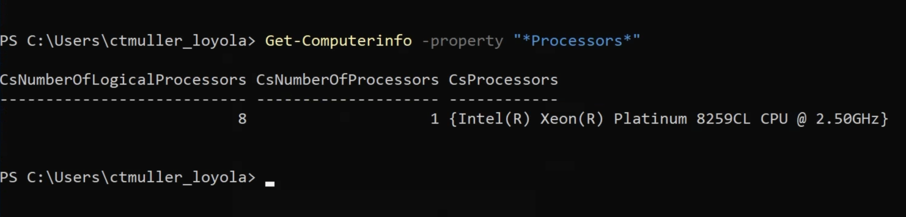
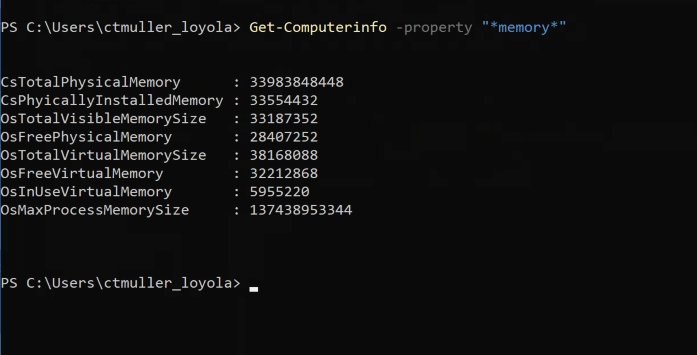

# Tutorial 1: System Information with Get-ComputerInfo

This tutorial uses the PowerShell `Get-ComputerInfo` cmdlet to pull processor and memory details for the local machine, filtering the output with the `-Property` parameter.

## Task 1: Computer Processor

The command `Get-ComputerInfo -Property "*Processors*"` filters the output to only properties containing "Processors". The results show the machine has **1 physical processor** — an Intel(R) Xeon(R) Platinum 8259CL CPU @ 2.50GHz — which exposes **8 logical processors** to the operating system, meaning the OS can schedule work across 8 threads simultaneously.

## Task 2: Computer Memory

The command `Get-ComputerInfo -Property "*memory*"` filters the output to properties containing "memory", giving a breakdown of the system's RAM and virtual memory:

- **CsTotalPhysicalMemory / CsPhyicallyInstalledMemory** – total physical RAM installed (~32 GB)
- - **OsTotalVisibleMemorySize / OsFreePhysicalMemory** – RAM visible to the OS and currently free (~27 GB free)
  - - **OsTotalVirtualMemorySize / OsFreeVirtualMemory / OsInUseVirtualMemory** – virtual memory (RAM + page file): total, free, and in use
    - - **OsMaxProcessMemorySize** – maximum memory a single process can address (128 GB, reflecting a 64-bit system)
      - [Processor Info](IM/TrueProc.png)
