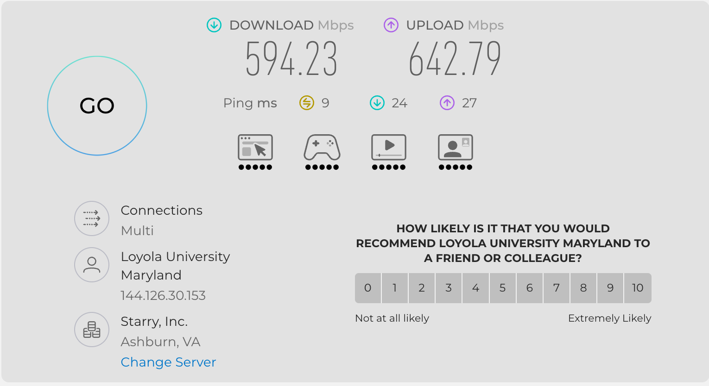
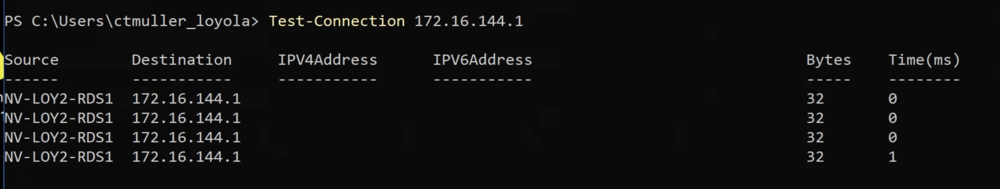

# Tutorial 2: 
## Task 1:Speed Test  
### Speed Test Analysis
The speed test results demonstrate a high-performance fiber connection delivering **594.23 Mbps download** and **642.79 Mbps upload** with an ultra-low **9 ms ping**. In practice, network throughput like this is determined by a combination of physical bandwidth limits, low latency, minimal packet loss, and robust local infrastructure—ensuring rapid data transmission without bottlenecks.

## Task 2: Network Infrastructure and Mapping Tools

To explore global internet routing, subsea cabling, and backbone transit topologies, the following resources were checked:

*   **Submarine Cable Map:** Explores active and planned underwater fiber-optic cables and landing stations connecting global continents.
*   **APNIC Resource Explorer:** A regional registry tool used to inspect IP address blocks, routing registries, and ASN details.
*   **AARNet International Network:** Maps high-capacity international and terrestrial links supporting education and research networks.
*   **Hurricane Electric Network Map:** A 3D interactive visualization illustrating global backbone transit infrastructure, Points of Presence            (PoPs), and data centers.

## Task 3: View a MAC Address with PowerShell
Get-NetAdapter and Get-NetAdapter -Physical

## Task 4: Use PowerShell to view and record the addresses of your own computer and local router information 
Get-NetIPConfiguration and Get-NetIPAddress -InterfaceIndex XX

## Task 5: Task 5. Test for connectivity between two devices on the Internet
Test-NetConnection X.X.X.X

Test-NetConnection X.X.X.X -count 10

