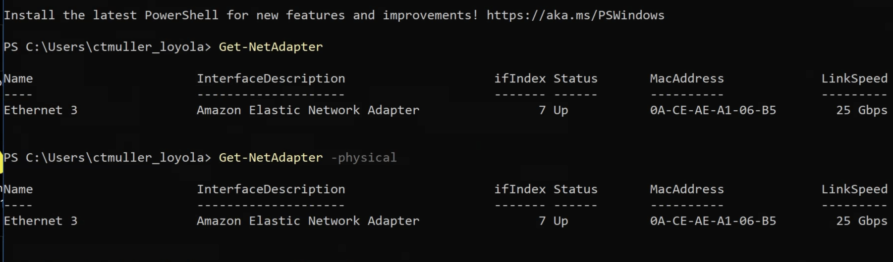
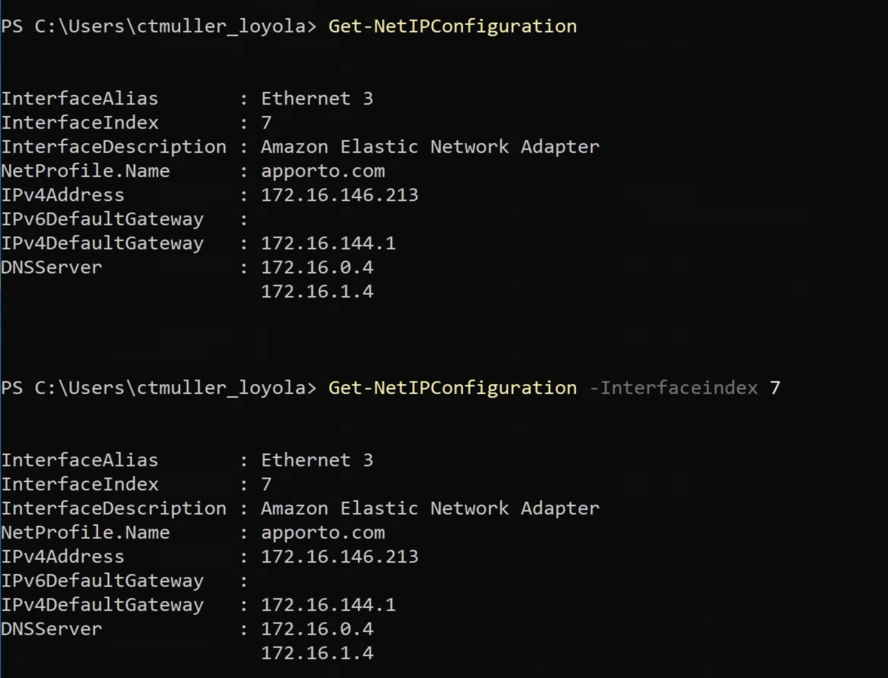
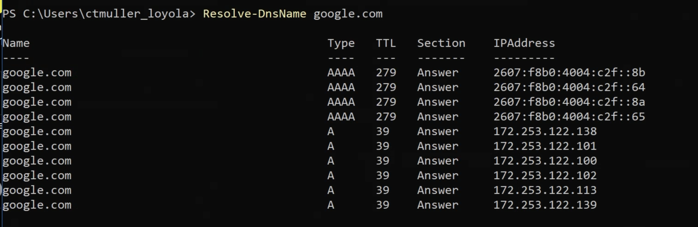
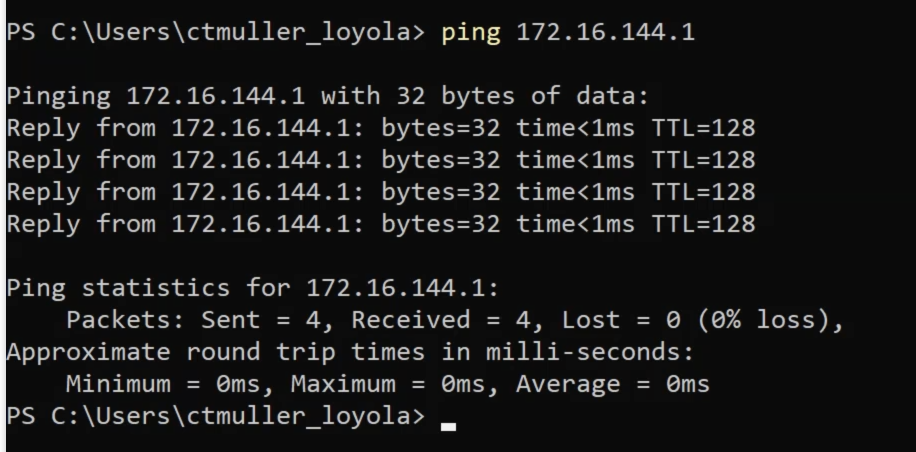
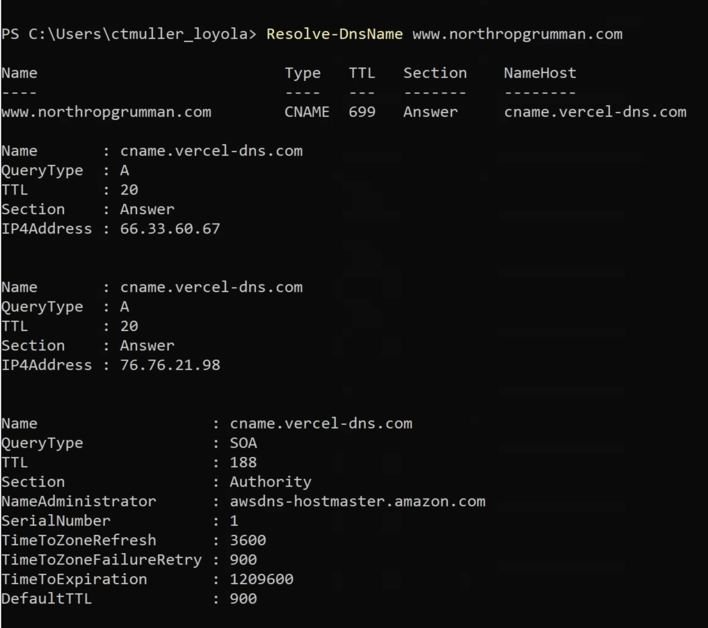

# Tutorial 2: 
## Task 1: Speed Test

### Speed Test Analysis

The speed test results demonstrate a high-performance fiber connection delivering **594.23 Mbps download** and **642.79 Mbps upload** with an ultra-low **9 ms ping**. In practice, network throughput like this is determined by a combination of physical bandwidth limits, low latency, minimal packet loss, and robust local infrastructure—ensuring rapid data transmission without bottlenecks.


## Task 2: Network Infrastructure and Mapping Tools

To explore global internet routing, subsea cabling, and backbone transit topologies, the following resources were checked:

*   **Submarine Cable Map:** Explores active and planned underwater fiber-optic cables and landing stations connecting global continents.
*   **APNIC Resource Explorer:** A regional registry tool used to inspect IP address blocks, routing registries, and ASN details.
*   **AARNet International Network:** Maps high-capacity international and terrestrial links supporting education and research networks.
*   **Hurricane Electric Network Map:** A 3D interactive visualization illustrating global backbone transit infrastructure, Points of Presence            (PoPs), and data centers.

## Task 3: View a MAC Address with PowerShell

### MAC Address Analysis via PowerShell

A **Media Access Control (MAC) address** is a unique, 48-bit physical hardware identifier assigned to a network interface card (NIC) at the factory. Operating at Layer 2 (Data Link) of the OSI model, MAC addresses facilitate frame delivery across local network segments.

To inspect local network adapters and identify physical hardware addresses, the following PowerShell cmdlets were executed:

* **`Get-NetAdapter`**: Retrieves a comprehensive list of all network adapters present on the system, including both physical hardware (Ethernet, Wi-Fi) and virtual interfaces (VPNs, virtual switches, hypervisor adapters). Key fields displayed include adapter `Name`, `InterfaceDescription`, operational `Status`, `MacAddress`, and `LinkSpeed`.
* **`Get-NetAdapter -Physical`**: Filters the output to display **only physical network hardware**, excluding virtual network interfaces, loopback adapters, and software tunnels to isolate the computer's actual physical MAC addresses.




## Task 4: View Local IP and Network Configuration with PowerShell

### Network Address Analysis via PowerShell

To inspect local IPv4/IPv6 network adapter configurations, default gateway routes, and interface properties, the following PowerShell cmdlets were executed:

* **`Get-NetIPConfiguration`**: Provides a consolidated overview of active network interfaces. Displays essential connectivity details including local IP addresses (`IPv4Address`), default gateway routes (`IPv4DefaultGateway`), and configured DNS servers.
* **`Get-NetIPAddress -InterfaceIndex XX`**: Queries address configuration details for a specific interface identified by its numerical index (`ifIndex`). Returns detailed IP properties, subnets, prefix lengths, and address origins for that interface.



## Task 5: Test for Connectivity Between Two Devices on the Internet

### Network Connectivity Testing via PowerShell

To test end-to-end layer 3 reachability, latency, and round-trip time (RTT) between local and remote network devices, the following commands were executed:

* **`Test-Connection <IP_Address>`**: Sends Internet Control Message Protocol (ICMP) Echo Request packets to a target IP address (such as the default gateway `172.16.144.1`) to verify active network connectivity and measure response times in milliseconds.
* **`Test-Connection <IP_Address> -Count 10`**: Performs an extended ICMP reachability test sending 10 consecutive packets to measure packet loss, stability, and round-trip latency over a larger sample size.


## Task 6: View DNS to IP Mappings in PowerShell

### Domain Name System (DNS) Resolution Analysis via PowerShell

To resolve human-readable domain names into network-routable IP addresses (A and AAAA records) and inspect DNS server response data, the following PowerShell cmdlet was executed:

* **`Resolve-DnsName google.com.au`**: Queries the configured local DNS server to resolve the domain `google.com.au`. It retrieves essential DNS resource records, including standard IPv4 addresses (`A` records), IPv6 addresses (`AAAA` records), TTL (Time To Live) cache values, and the query status to confirm successful domain name resolution.



## Task 7: Ping Your Local Router

### Default Gateway Discovery and Latency Analysis via PowerShell

To evaluate local network response time and packet loss to the default gateway (`172.16.144.1`), the `ping` command was executed:

* **Command Executed:**

```powershell
ping 172.16.144.1
```



**Results:** Minimum = [0] ms, Average = [0] ms, Maximum = [0] ms, Packet loss = [0]%.

**Discussion:** The round-trip delay to a local default gateway is normally very low (sub-millisecond to a few ms) since traffic never leaves the LAN. Factors that can affect the delay include network congestion (other devices on the same Wi-Fi/switch competing for bandwidth), the connection medium (Wi-Fi introduces more variability than a wired Ethernet link due to signal interference and retransmissions), CPU/interrupt load on the router itself, and background traffic. Delay can vary over time because Wi-Fi channel conditions change (interference from neighboring networks, physical obstructions, distance from the access point), and because router CPU load fluctuates as more devices connect or as it processes more traffic (e.g., during peak household usage hours).

## Task 8: Find Addresses for a Website

### Comprehensive Web Address Discovery via PowerShell

To discover and document all available addressing information for a selected target website, the official domain **[www.northropgrumman.com](https://www.northropgrumman.com)** was analyzed using DNS lookup cmdlets in PowerShell.

* **Command Executed:**

```powershell
Resolve-DnsName www.northropgrumman.com
```

#### Address Records Retrieved

* **Domain Name (FQDN):** `www.northropgrumman.com`
* **Canonical Name (CNAME):** `cname.vercel-dns.com` (indicates DNS routing and hosting through Vercel's edge network)
* **IPv4 Addresses (A Records):**
  * `66.33.60.67`
  * `76.76.219.98`
* **IPv6 Addresses (AAAA Records):**
  * None returned in query output.

---



#### Discussion & Missing Address Analysis

* **How Addresses Were Found:**
  The addressing information was obtained by executing `Resolve-DnsName www.northropgrumman.com` in PowerShell. The cmdlet queried the local DNS server to resolve the domain into its associated CNAME record and public IPv4 addresses.

* **MAC (Physical) Address:**
  * **Status:** Unavailable / Not Found.
  * **Explanation:** A MAC address operates strictly at Layer 2 (Data Link layer) of the OSI model and is only used to route frames within a local network segment (LAN). Once network traffic traverses a Layer 3 router onto the public Internet, the local MAC address header is stripped and replaced at each routing hop. Because `www.northropgrumman.com` is hosted on remote web servers, its physical MAC address is not accessible or exposed to end users.

* **Internal / Private IP Address:**
  * **Status:** Unavailable / Not Found.
  * **Explanation:** Enterprise web applications sit behind reverse proxies and Content Delivery Networks (Vercel). The IP addresses returned (`66.33.60.67`, `76.76.219.98`) belong to public edge proxy servers. The origin server's private IP address is concealed behind Network Address Translation (NAT) and perimeter firewalls to protect internal systems from direct cyber attacks.
