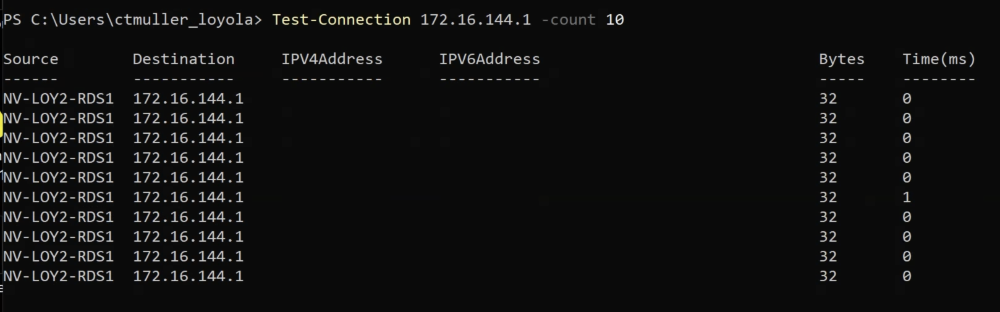

# Tutorial 2: 
## Task 1:Speed Test  
### Speed Test Analysis
The speed test results demonstrate a high-performance fiber connection delivering **594.23 Mbps download** and **642.79 Mbps upload** with an ultra-low **9 ms ping**. In practice, network throughput like this is determined by a combination of physical bandwidth limits, low latency, minimal packet loss, and robust local infrastructure—ensuring rapid data transmission without bottlenecks.

## Task 2: Network Infrastructure and Mapping Tools

To explore global internet routing, subsea cabling, and backbone transit topologies, the following resources were checked:

*   **Submarine Cable Map:** Explores active and planned underwater fiber-optic cables and landing stations connecting global continents.
*   **APNIC Resource Explorer:** A regional registry tool used to inspect IP address blocks, routing registries, and ASN details.
*   **AARNet International Network:** Maps high-capacity international and terrestrial links supporting education and research networks.
*   **Hurricane Electric Network Map:** A 3D interactive visualization illustrating global backbone transit infrastructure, Points of Presence            (PoPs), and data centers.

## Task 3: View a MAC Address with PowerShell

### MAC Address Analysis via PowerShell

A **Media Access Control (MAC) address** is a unique, 48-bit physical hardware identifier assigned to a network interface card (NIC) at the factory. Operating at Layer 2 (Data Link) of the OSI model, MAC addresses facilitate frame delivery across local network segments.

To inspect local network adapters and identify physical hardware addresses, the following PowerShell cmdlets were executed:

* **`Get-NetAdapter`**: Retrieves a comprehensive list of all network adapters present on the system, including both physical hardware (Ethernet, Wi-Fi) and virtual interfaces (VPNs, virtual switches, hypervisor adapters). Key fields displayed include adapter `Name`, `InterfaceDescription`, operational `Status`, `MacAddress`, and `LinkSpeed`.
* **`Get-NetAdapter -Physical`**: Filters the output to display **only physical network hardware**, excluding virtual network interfaces, loopback adapters, and software tunnels to isolate the computer's actual physical MAC addresses.

## Task 4: View Local IP and Network Configuration with PowerShell

### Network Address Analysis via PowerShell

To inspect local IPv4/IPv6 network adapter configurations, default gateway routes, and interface properties, the following PowerShell cmdlets were executed:

* **`Get-NetIPConfiguration`**: Provides a consolidated overview of active network interfaces. Displays essential connectivity details including local IP addresses (`IPv4Address`), default gateway routes (`IPv4DefaultGateway`), and configured DNS servers.
* **`Get-NetIPAddress -InterfaceIndex XX`**: Queries address configuration details for a specific interface identified by its numerical index (`ifIndex`). Returns detailed IP properties, subnets, prefix lengths, and address origins for that interface.

## Task 5: Test for Connectivity Between Two Devices on the Internet

### Network Connectivity Testing via PowerShell

To test end-to-end layer 3 reachability, latency, and round-trip time (RTT) between local and remote network devices, the following commands were executed:

* **`Test-Connection <IP_Address>`**: Sends Internet Control Message Protocol (ICMP) Echo Request packets to a target IP address (such as the default gateway `172.16.144.1`) to verify active network connectivity and measure response times in milliseconds.
* **`Test-Connection <IP_Address> -Count 10`**: Performs an extended ICMP reachability test sending 10 consecutive packets to measure packet loss, stability, and round-trip latency over a larger sample size.

