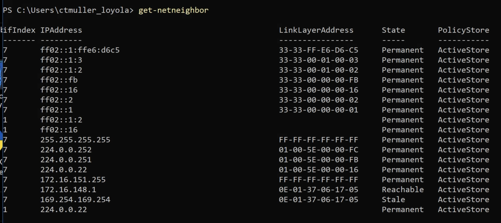

# IS355: Tutorial 3 

## Task 1: View ARP Table

### Purpose of ARP Packets
The Address Resolution Protocol (ARP) translates a known Layer 3 IP address (such as `172.16.148.1`) into its corresponding Layer 2 physical MAC address (such as `0E-01-37-06-17-05`). Since local Ethernet communication relies on MAC addresses to frame and deliver data across a local area network (LAN), ARP allows a host to discover where to direct frames when it only knows a target's IP address.

### ARP Table Capture
Below is the output of the ARP table retrieved using PowerShell (`Get-NetNeighbor`):

### Reachable Devices
* **Device 1 MAC Address:** `0E-01-37-06-17-05`
  * **Device Identity:** Default Gateway (`172.16.148.1`)
  * **Explanation:** This MAC address belongs to the primary local network gateway. It is listed as "Reachable" because active ICMP/IP traffic was recently exchanged with this address on the local subnet.

* **Device 2 MAC Address:** `0E-01-37-06-17-05`
  * **Device Identity:** Virtual Subnet Metadata / Service Endpoint (`169.254.169.254`)
  * **Explanation:** This MAC address maps to the virtual network service interface on the subnet. It appears in the ARP table in a "Stale" state following prior communication with the host environment.
  * 
## Task 2: Draw Network Diagrams

%%{init: {'theme':'base', 'themeVariables': {'primaryTextColor':'#333', 'lineColor':'#ccc'}, 'securityLevel':'loose'}}%%
graph TD
    %% Define Styles
    classDef pc fill:#f9f,stroke:#333,stroke-width:2px,rx:10,ry:10;
    classDef switch fill:#ff9,stroke:#333,stroke-width:2px;
    classDef title fill:none,stroke:none;

    %% Add Name and Date - Top Left
    Name[Colin Muller]:::title
    Date[October 26, 2023]:::title
    Title[Diagram A: Switched LAN with 1 Switch, 4 PCs]:::title

    %% Core Components
    subgraph LAN_A ["A: Single Switch LAN"]
        direction LR
        Switch[SW-01]:::switch
        PC01[PC-01]:::pc
        PC02[PC-02]:::pc
        PC03[PC-03]:::pc
        PC04[PC-04]:::pc

        %% Connections
        Switch -->|F0/1| PC01
        Switch -->|F0/2| PC02
        Switch -->|F0/3| PC03
        Switch -->|F0/4| PC04
    end

    %% Hide original name/date on chart
    linkStyle 0,1,2 stroke-width:0px;
    
    %% Add Name, Date, Title into the actual chart structure for export
    LAN_A ~~~ Name
    Name ~~~ Date
    Date ~~~ Title

---

## Task 4: Learning Reflection

### Tools & Commands Used (Weeks 1–3)
1. **PowerShell Cmdlets:** `Get-NetAdapter`, `Get-NetIPAddress`, `Get-NetNeighbor`
2. **Command Line Utilities:** `ping`, `tracert`, `arp`
3. **Diagramming Software:** diagrams.net (`app.diagrams.net`)
4. **Version Control:** Git & GitHub

### Practical Tool Application Outside IS355
* **Selected Tool:** `ping` / PowerShell Network Cmdlets (`Get-NetIPAddress`, `Get-NetNeighbor`)
* **Practical Application & Utility:**  
  Understanding basic network diagnostic tools like `ping` and IP listing commands is extremely practical for managing a home network and troubleshooting connectivity issues across other IT and enterprise software coursework. 
  
  For example, if a home smart device, printer, or local server goes offline, running `ping` allows you to immediately isolate whether the issue is a physical connectivity failure on the LAN or a higher-layer application fault. Additionally, inspecting the local ARP table (`Get-NetNeighbor`) allows you to verify whether your computer is physically communicating with a router or local target without needing to log into the router's web interface.
