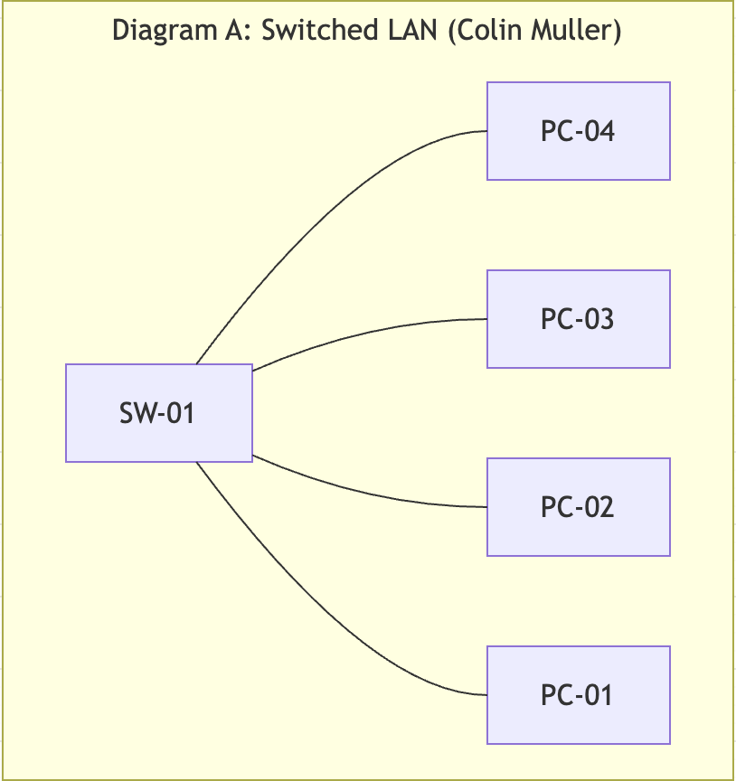
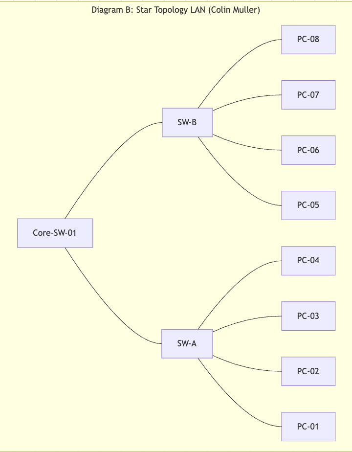

# IS355: Tutorial 3 

## Task 1: View ARP Table

### Purpose of ARP Packets
The Address Resolution Protocol (ARP) translates a known Layer 3 IP address (such as `172.16.148.1`) into its corresponding Layer 2 physical MAC address (such as `0E-01-37-06-17-05`). Since local Ethernet communication relies on MAC addresses to frame and deliver data across a local area network (LAN), ARP allows a host to discover where to direct frames when it only knows a target's IP address.

### ARP Table Capture
Below is the output of the ARP table retrieved using PowerShell (`Get-NetNeighbor`):

### Reachable Devices
- **Device 1 MAC Address:** `0E-01-37-06-17-05`
  - **Device Identity:** Default Gateway (`172.16.148.1`)
  - **Explanation:** This MAC address belongs to the primary local network gateway. It is listed in a `Reachable` state because active traffic was recently exchanged with this address.

- **Device 2 MAC Address:** `0E-01-37-06-17-05`
  - **Device Identity:** Link-Local / Virtual Service Endpoint (`169.254.169.254`)
  - **Explanation:** This IP maps to a virtual endpoint on the network interface. It is currently listed in a `Stale` state because no traffic has been exchanged with it within the reachability timeout window.

  ## Task 2: Draw Network Diagrams

### Diagram A: Single Switch LAN (4 PCs)
* **Image File:** 
* **Editable File:**  

### Diagram B: Star Topology LAN (3 Switches, 8 PCs)
* **Image File:** 
* **Editable File:** 

## Task 4: Learning Reflection

### Tools and Commands Learned (Weeks 1–3)
* **PowerShell Network Cmdlets:** `Get-NetAdapter`, `Get-NetIPAddress`, `Get-NetNeighbor`
* **Command Line Network Utilities:** `ping`, `tracert`, `arp`, `ipconfig`
* **Network Diagramming Software:** [draw.io (diagrams.net)](https://app.diagrams.net/)
* **Version Control & Documentation:** Git and GitHub (Markdown editing)

### Practical Application of a Selected Tool
* **Selected Tool:** `ping` & PowerShell Network Cmdlets (`Get-NetNeighbor`, `Get-NetIPAddress`)
* **Practical Utility Outside IS355:**  
  Understanding basic command-line network diagnostic tools like `ping` and `Get-NetNeighbor` is extremely practical for managing home network infrastructure and troubleshooting connectivity issues in other IT/data systems coursework. 

  For example, if a home smart device, network printer, or local server becomes unresponsive, running a quick `ping` command immediately isolates whether the issue is a basic Layer 2/3 physical connection failure on the local subnet or a higher-layer application/software glitch. Furthermore, checking the local ARP table via `Get-NetNeighbor` allows you to confirm that your workstation has discovered the device's hardware (MAC) address without having to log into a router administrator interface.

