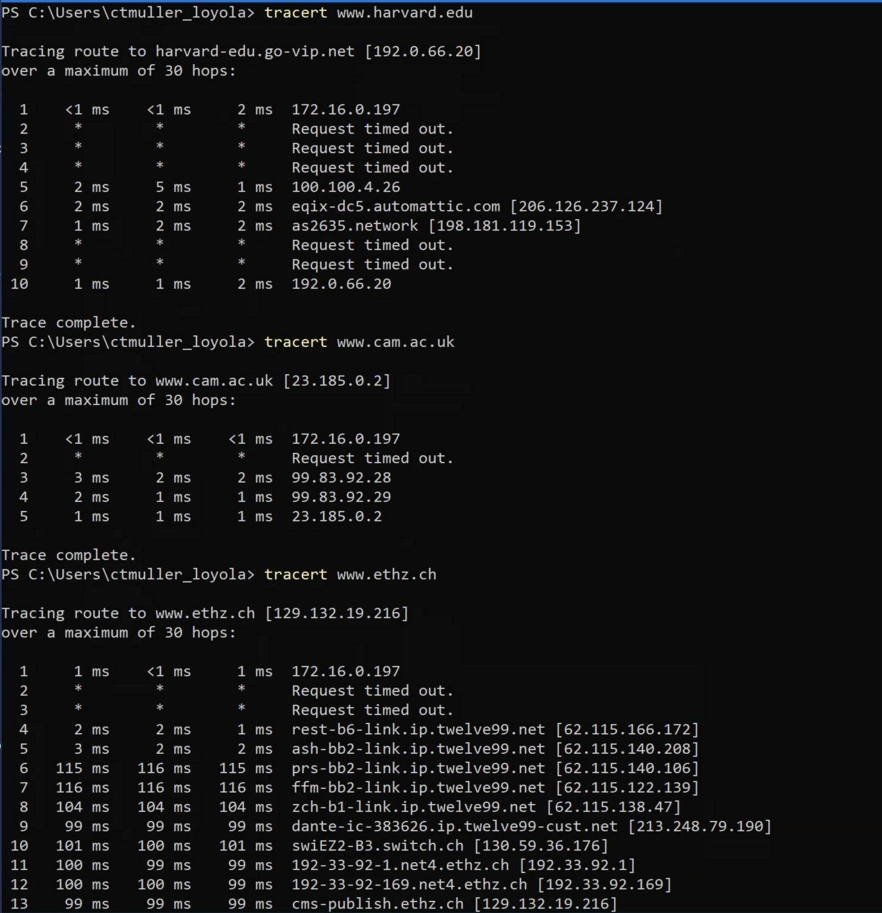

# IS355: Tutorial 4 - Routing, Traceroute, and IP Geolocation

## Task 1: View Routing Table

| DestinationPrefix | NextHop | RouteMetric | Detailed Description |
| :--- | :--- | :--- | :--- |
| **`0.0.0.0/0`** | `172.16.144.1` | `0` | **Default Gateway Route:** Matches any IP destination outside the local network. All outbound Internet/external traffic is forwarded to the default gateway address `172.16.144.1`. |
| **`172.16.144.0/22`** | `0.0.0.0` (On-Link) | `256` | **Local Subnet Route:** Specifies that all destination IP addresses within the `/22` subnet (`172.16.144.1` – `172.16.147.254`) reside on the directly connected local network link and do not require router forwarding. |
| **`172.16.146.211/32`** | `0.0.0.0` (On-Link) | `256` | **Primary Host Interface Route:** Represents the exact IPv4 address assigned to this computer's primary network card (`/32` host mask). Traffic sent to this address is handled internally by the local network stack. |
| **`172.16.147.255/32`** | `0.0.0.0` (On-Link) | `256` | **Subnet Directed Broadcast Route:** Directs local broadcast packets across the entire `/22` subnet segment. |
| **`169.254.169.x/32`** | `172.16.144.1` | `15` | **Virtual Environment Service Routes:** Specific link-local endpoint routes (e.g., `169.254.169.254`) used by the Apporto cloud infrastructure to communicate with internal metadata services via the gateway. |
| **`224.0.0.0/4`** | `0.0.0.0` (On-Link) | `256` | **Multicast Address Range:** Reserved for IPv4 multicast communication (`224.0.0.0` through `239.255.255.255`) across local subscribing devices. |
| **`255.255.255.255/32`** | `0.0.0.0` (On-Link) | `256` | **Limited Broadcast Route:** Directs local broadcast messages to all nodes on the immediate physical network link. |

## Task 2: Trace Path Through the Internet

### Execution & Screenshot
To analyze internet routing pathways, hop counts, and round-trip delays, three target destinations were tested using `tracert` in Command Prompt:
1. **Domestic Target:** `www.harvard.edu`
2. **International Target 1 (UK):** `www.cam.ac.uk`
3. **International Target 2 (Switzerland):** `www.ethz.ch`

---

### Discussion & Findings

#### Summary Table
| Target Destination | Resolved IP | Total Hops | Final RTT (ms) | Identifiable Networks / ISPs |
| :--- | :--- | :--- | :--- | :--- |
| **`www.harvard.edu`** | `192.0.66.20` | 10 | ~2 ms | Local Gateway, Automattic Edge (`206.126.237.124`), VIP Edge |
| **`www.cam.ac.uk`** | `23.185.0.2` | 5 | ~1 ms | Local Gateway, Anycast Edge CDN (`99.83.92.28`) |
| **`www.ethz.ch`** | `129.132.19.216` | 13 | ~99 ms | Arelion (Twelve99), SWITCH Network (`130.59.36.176`) |

#### General Observations
* **Number of Hops:** Hops ranged from 5 to 13. Targets behind global Content Delivery Networks (CDNs) like `www.cam.ac.uk` and `www.harvard.edu` resolved quickly in few hops because traffic terminated at local US East Coast edge servers.
* **Approximate Round-Trip Delay (RTT):** Local and CDN edge destinations registered minimal latency ($1\text{--}2\text{ ms}$). Destinations routing directly to European origin servers registered significantly higher latency ($\approx 99\text{ ms}$).
* **Identifiable ISPs & Providers:** Transit providers identified along the routes included Tier-1 backbone carrier **Arelion / Twelve99** (`ip.twelve99.net`), content networks like **Automattic** (`206.126.237.124`), and national academic networks like **SWITCH** in Switzerland.

---

### Detailed Analysis of International Destination: `www.ethz.ch`

#### 1. Traffic Traversal Across Networks
* **Local & Domestic Exit (Hops 1–5):** Packets originated from the local network gateway (`172.16.144.1`) and routed through local infrastructure to an internet exchange in Ashburn, VA (`ash-bb2-link.ip.twelve99.net`).
* **Transatlantic Handoff (Hops 5–6):** Traffic entered Arelion's global backbone network and crossed transatlantic subsea cables, connecting Ashburn to Paris (`prs-bb2-link.ip.twelve99.net`).
* **European Transit & Destination (Hops 6–13):** Data routed through major European network hubs in Paris, Frankfurt (`ffm-bb2`), and Zürich (`zch-b1`), before handing off to **SWITCH** (the Swiss National Research and Education Network) to reach ETH Zürich's web server (`cms-publish.ethz.ch`).

#### 2. Physical Locations of Intermediate Routers
* **Ashburn, Virginia, USA (`ash-bb2`):** Primary internet traffic exchange hub on the US East Coast.
* **Paris, France (`prs-bb2`):** Transatlantic subsea landing point and major European internet exchange.
* **Frankfurt, Germany (`ffm-bb2`):** Central European routing and transit exchange node.
* **Zürich, Switzerland (`zch-b1`):** Local regional destination router leading to the university network.

#### 3. Factors Affecting Internet Delay vs. Local Communications
* **Geographical Distance & Propagation Speed:** Light travels through fiber optic cables at roughly $200,000\text{ km/s}$ ($\frac{2}{3}c$). Traveling several thousand miles across the Atlantic Ocean enforces a physical minimum delay ($\approx 60\text{--}80\text{ ms}$) that cannot be reduced by hardware upgrades.
* **Intermediate Hop Count & Processing:** Every router along the 13-hop path must inspect packet headers, perform routing table lookups, and queue packets for transmission, adding processing delay at each node.
* **Network Congestion & BGP Routing:** Local network traffic operates across high-speed dedicated switches ($<1\text{ ms}$), whereas international traffic crosses multiple peering points subject to dynamic Border Gateway Protocol (BGP) routing and variable traffic congestion.

