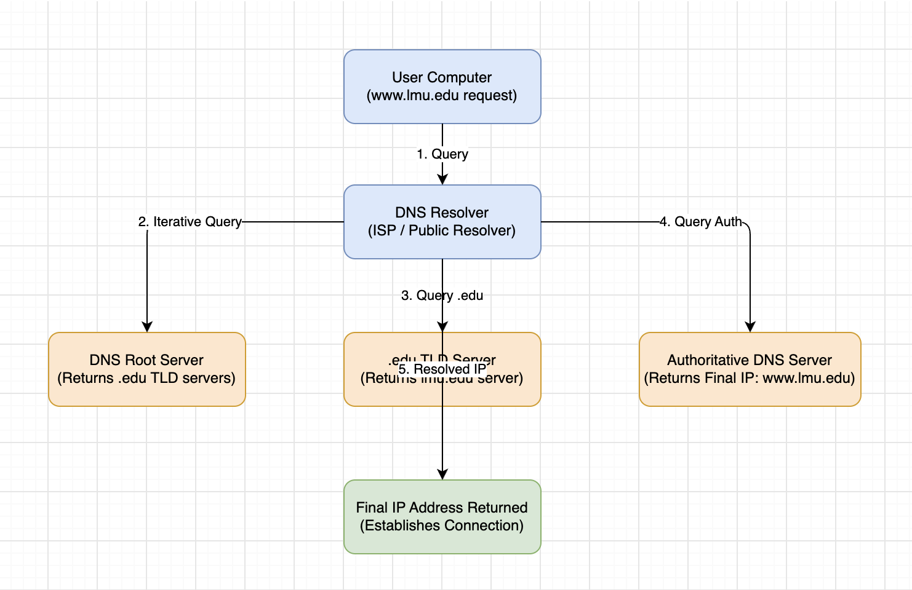
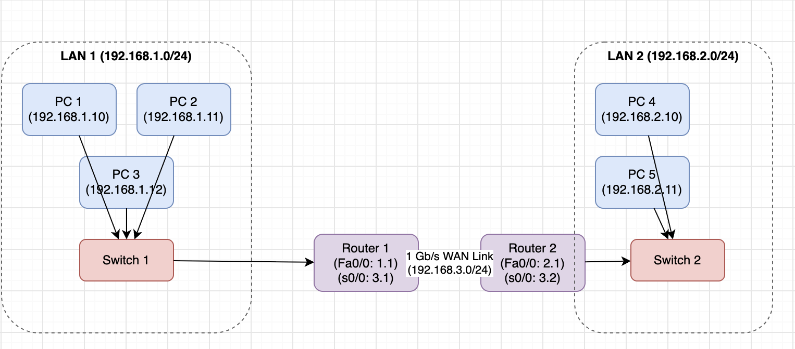

# IS355: Tutorial 5 - Browser Cookies, DNS Resolution, and IP Network Design
---

[Course Journal](Main.md) | [Tutorial 4](Tutorial4.md) | [Group Project Repository](https://github.com/Ctmuller/IS355_GroupProject)

## Table of Contents

- [Task 1: View Your Cookies](#task-1-view-your-cookies)
- [Task 2: DNS Root Servers & Resolution Process](#task-2-dns-root-servers--resolution-process)
- [Task 3: IP Network Design](#task-3-ip-network-design)

---

## Task 1: View Your Cookies

### Overview & Inspection
Cookies are small data files sent by web servers and stored locally by the web browser to maintain session state, store user settings, and track activity across browsing sessions.

### Data Types Stored in Cookies
* **Session Identifiers:** Cryptographic tokens (e.g., `PHPSESSID`, `JSESSIONID`, `auth_token`) that keep users logged into web applications without re-authenticating on every page load.
* **User Preferences:** Client-side configuration flags such as preferred language, dark/light theme settings, and UI display options.
* **Tracking & Analytics:** First-party and third-party tracking identifiers (e.g., `_ga`, `_gid` used by Google Analytics) to record page visits, navigation paths, and user engagement metrics.
* **Security & Verification Tokens:** Anti-CSRF tokens (`XSRF-TOKEN`) cross-checked by web servers to prevent Cross-Site Request Forgery attacks on state-changing requests.
* **Metadata & Attributes:** Operational parameters specifying cookie lifetime (`Expires`/`Max-Age`), domain/path scope, and security flags (`Secure`, `HttpOnly`, `SameSite`).

---

## Task 2: DNS Root Servers & Resolution Process

### Role of DNS Root Servers
The DNS Root Servers sit at the apex of the Domain Name System hierarchy. They do not store destination IP addresses for specific domains like `www.lmu.edu`. Instead, root servers inspect the Top-Level Domain (TLD) suffix (`.edu`) of incoming recursive queries and direct the DNS resolver to the appropriate TLD name servers.

### Sequential DNS Lookup Process
1. **Local Request:** The user enters `www.lmu.edu` into a web browser. The local OS checks its DNS cache and local `hosts` file.
2. **Recursive Resolver Query:** If un-cached, the client forwards a recursive DNS request to the configured **DNS Resolver** (e.g., ISP DNS server or public resolver).
3. **Root Server Query:** The DNS Resolver sends an iterative query for `www.lmu.edu` to a **DNS Root Server**.
4. **Root Referral:** The Root Server returns the IP addresses of the authoritative **.edu TLD Servers**.
5. **TLD Server Query:** The DNS Resolver queries the **.edu TLD Server** for `www.lmu.edu`.
6. **TLD Referral:** The TLD Server returns the IP address of the **Authoritative DNS Server** responsible for `lmu.edu`.
7. **Authoritative Query & Response:** The DNS Resolver queries the **Authoritative DNS Server**, which returns the destination IPv4 address for `www.lmu.edu`.
8. **Final IP Return & TCP Handshake:** The DNS Resolver returns the IP address to the user's computer and caches the result. The browser then establishes an HTTP/HTTPS TCP session with the target server.

### DNS Resolution Flow Diagram

## Task 3: IP Network Design

### a) IP Address Allocation Table

| Device / Component | Interface | Assigned IPv4 Address | Subnet Mask | Gateway / Notes |
| :--- | :--- | :--- | :--- | :--- |
| **Router 1 (R1)** | `Fa0/0` (LAN 1) | `192.168.1.1` | `255.255.255.0` (/24) | Default Gateway for PCs on LAN 1 |
| | `s0/0` (WAN) | `192.168.3.1` | `255.255.255.0` (/24) | Point-to-point to R2 |
| **PC 1 (LAN 1)** | `NIC` | `192.168.1.10` | `255.255.255.0` (/24) | Gateway: `192.168.1.1` |
| **PC 2 (LAN 1)** | `NIC` | `192.168.1.11` | `255.255.255.0` (/24) | Gateway: `192.168.1.1` |
| **PC 3 (LAN 1)** | `NIC` | `192.168.1.12` | `255.255.255.0` (/24) | Gateway: `192.168.1.1` |
| **Router 2 (R2)** | `Fa0/0` (LAN 2) | `192.168.2.1` | `255.255.255.0` (/24) | Default Gateway for PCs on LAN 2 |
| | `s0/0` (WAN) | `192.168.3.2` | `255.255.255.0` (/24) | Point-to-point to R1 |
| **PC 4 (LAN 2)** | `NIC` | `192.168.2.10` | `255.255.255.0` (/24) | Gateway: `192.168.2.1` |
| **PC 5 (LAN 2)** | `NIC` | `192.168.2.11` | `255.255.255.0` (/24) | Gateway: `192.168.2.1` |

### b) Network Diagram Topology

### c) Simplified Routing Tables

#### **Router 1 Routing Table**
| Network Destination | Subnet Mask | Next Hop / Interface | Metric |
| :--- | :--- | :--- | :--- |
| `192.168.1.0` | `255.255.255.0` | `Directly Connected (Fa0/0)` | 0 |
| `192.168.3.0` | `255.255.255.0` | `Directly Connected (s0/0)` | 0 |
| `192.168.2.0` | `255.255.255.0` | `192.168.3.2` (via R2) | 1 |

#### **Router 2 Routing Table**
| Network Destination | Subnet Mask | Next Hop / Interface | Metric |
| :--- | :--- | :--- | :--- |
| `192.168.2.0` | `255.255.255.0` | `Directly Connected (Fa0/0)` | 0 |
| `192.168.3.0` | `255.255.255.0` | `Directly Connected (s0/0)` | 0 |
| `192.168.1.0` | `255.255.255.0` | `192.168.3.1` (via R1) | 1 |
