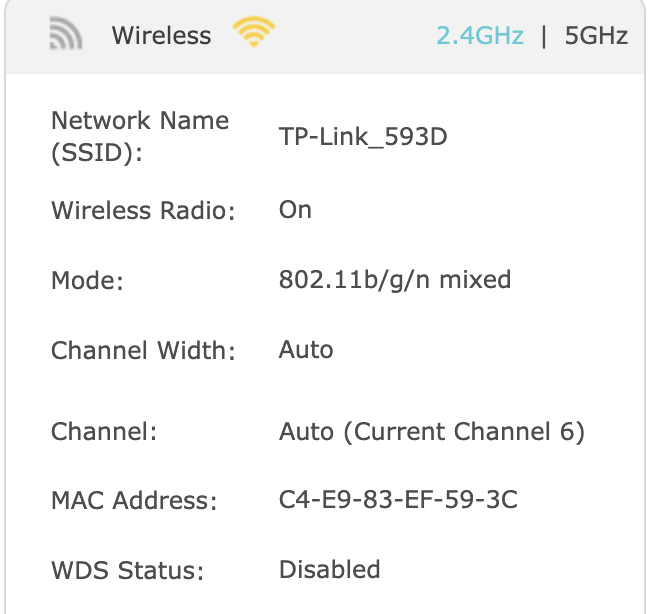
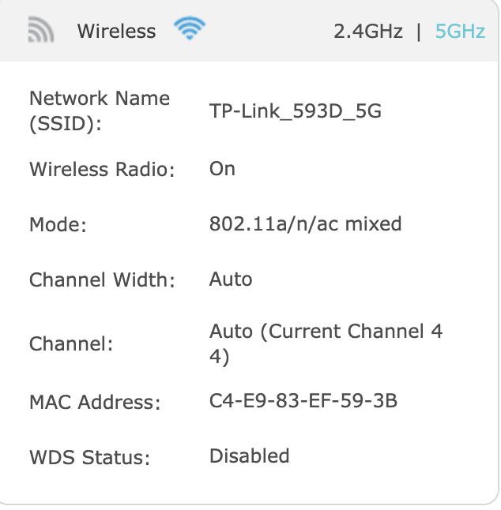

# IS355: Tutorial 6 - Wireless Networks

## Table of Contents

- [Task 1: View Wi-Fi Details](#task-1-view-wi-fi-details)
- [Task 2: Use Wi-Fi Access Point](#task-2-use-wi-fi-access-point)
- [Task 3: Continue Your Project](#task-3-continue-your-project)

---

## Task 1: View Wi-Fi Details

### Overview & Inspection
Wireless networks use radio frequencies to allow devices to communicate with Wireless Access Points (APs) without requiring physical Ethernet connections. Each access point broadcasts a Service Set Identifier (SSID), allowing nearby devices to identify and connect to the network.

Wi-Fi networks commonly operate on the **2.4 GHz, 5 GHz, and 6 GHz frequency bands**, depending on the wireless standard and device capabilities.

For this activity, I examined my MacBook's wireless connection to **HoundNet**, Loyola University Maryland's wireless network, using the macOS Wi-Fi information menu.

### Wi-Fi Inspection Method

On macOS, holding the **Option (⌥)** key while clicking the Wi-Fi icon displays detailed wireless connection information, including the SSID, BSSID, frequency band, channel, signal strength, and transmission rate.

I used this method to collect information about my active wireless connection.

### Wireless Access Point Information

| Property | Access Point 1 |
| :--- | :--- |
| **SSID** | HoundNet |
| **BSSID** | `94:64:24:fc:45:d4` |
| **Frequency Band** | 6 GHz |
| **Channel** | 101 |
| **Channel Width** | 160 MHz |
| **Data Rate (Tx Rate)** | 1,729 Mbps |
| **Wireless Security** | WPA2 Enterprise |
| **Wi-Fi Standard** | 802.11ax |
| **Signal Strength (RSSI)** | -54 dBm |
| **Noise Level** | -94 dBm |
| **MCS Index** | 8 |
| **Spatial Streams (NSS)** | 2 |

### IP Network Configuration

My MacBook received its IP configuration automatically through DHCP.

| Property | Observed Value |
| :--- | :--- |
| **IPv4 Address** | `10.233.153.197` |
| **Subnet Mask** | `255.255.224.0` (/19) |
| **Default Gateway** | `10.233.128.1` |
| **IP Configuration** | DHCP |
| **IPv6 Configuration** | Automatic |

### Understanding Wireless Network Properties

* **SSID (Service Set Identifier):** HoundNet identifies the wireless network provided by Loyola University Maryland.
* **BSSID (Basic Service Set Identifier):** The address `94:64:24:fc:45:d4` identifies the specific wireless access point radio to which my MacBook was connected.
* **Frequency Band:** The connection uses the 6 GHz frequency band, providing additional wireless spectrum and supporting high-speed data transmission.
* **Wireless Channel:** Channel 101 identifies the operating channel. The 160 MHz channel width allows the connection to utilize a wider portion of the available frequency spectrum.
* **Data Rate:** The negotiated transmission rate was 1,729 Mbps. This represents the wireless link rate rather than actual internet throughput.
* **Wireless Security:** WPA2 Enterprise provides enterprise authentication and encryption for organizational wireless networks.
* **Signal Strength:** The RSSI of -54 dBm indicates a strong wireless signal.
* **Noise Level:** The reported noise level was -94 dBm, producing a signal-to-noise ratio of approximately 40 dB.

### Observations & Analysis

The HoundNet wireless connection operated using the **802.11ax standard on the 6 GHz frequency band**, with a negotiated transmission rate of 1,729 Mbps.

The connection demonstrated strong signal quality, with an RSSI of -54 dBm and a signal-to-noise ratio of approximately 40 dB.

The 160 MHz channel width provides substantial potential wireless throughput, although actual performance depends on network congestion, interference, and other environmental conditions.

This activity demonstrated how wireless network information can be used to evaluate connectivity, identify possible interference, and troubleshoot network performance.

---

## Task 2: Use Wi-Fi Access Point

### Overview & Configuration

Wireless Access Points provide connectivity between wireless devices and wired networks. Their management interfaces allow administrators to configure wireless security, frequency bands, network identifiers, authentication methods, and access restrictions.

For this activity, I explored the **TP-Link Archer C6 wireless router** using the TP-Link online router emulator.

**TP-Link Emulator:** https://www.tp-link.com/au/support/emulator/

The Archer C6 supports both 2.4 GHz and 5 GHz wireless networks and provides configuration options for wireless channels, network names, operating modes, and guest connectivity.

### Router Overview

The emulator displayed an active internet connection, two wired clients, and zero wireless clients.

| Property | Observed Value |
| :--- | :--- |
| **Router Model** | TP-Link Archer C6 |
| **Internet Connection** | Connected |
| **Wireless Bands** | 2.4 GHz and 5 GHz |
| **Wired Clients** | 2 |
| **Wireless Clients** | 0 |
| **2.4 GHz Guest Network** | Disabled |
| **5 GHz Guest Network** | Disabled |

### 2.4 GHz Wireless Configuration

I examined the 2.4 GHz wireless settings to identify the network's operating mode, channel selection, and access point information.

| Configuration Setting | Observed Value |
| :--- | :--- |
| **Network Name (SSID)** | TP-Link_593D |
| **Wireless Radio** | Enabled |
| **Wireless Mode** | 802.11b/g/n mixed |
| **Channel Width** | Auto |
| **Wireless Channel** | Auto (Current Channel 6) |
| **MAC Address** | C4-E9-83-EF-59-3C |
| **WDS Status** | Disabled |
| **Guest Network** | Disabled |

### 5 GHz Wireless Configuration

I also examined the 5 GHz wireless settings to compare the router's frequency bands and supported wireless standards.

| Configuration Setting | Observed Value |
| :--- | :--- |
| **Network Name (SSID)** | TP-Link_593D_5G |
| **Wireless Radio** | Enabled |
| **Wireless Mode** | 802.11a/n/ac mixed |
| **Channel Width** | Auto |
| **Wireless Channel** | Auto (Current Channel 44) |
| **MAC Address** | C4-E9-83-EF-59-3B |
| **WDS Status** | Disabled |
| **Guest Network** | Disabled |

### Connected Wired Clients

The Archer C6 router emulator also displayed two wired devices connected to the local network.

| Device Name | IPv4 Address | MAC Address |
| :--- | :--- | :--- |
| **LEO-MS-7529** | `192.168.0.24` | `F8-D1-11-B5-44-78` |
| **TPUSER** | `192.168.0.27` | `40-8D-5C-21-72-F6` |

Both devices use private IPv4 addresses within the `192.168.0.x` range.

The router's client management interface allows administrators to identify connected devices and review assigned IP addresses and MAC addresses.

### Important Wireless Access Point Settings

| Setting | Recommended Configuration | Security / Performance Consideration |
| :--- | :--- | :--- |
| **SSID** | Unique, recognizable network name | Identifies the network without exposing sensitive information |
| **Wireless Security** | WPA3-Personal or WPA2-AES | Protects wireless communication through encryption and authentication |
| **Wi-Fi Password** | Strong, unique password | Prevents unauthorized wireless access |
| **Frequency Band** | 5 GHz for high-performance devices; 2.4 GHz for compatibility | Balances speed, range, and device support |
| **Wireless Channel** | Select channels with minimal interference | Reduces congestion and improves connection stability |
| **Channel Width** | 20 MHz on 2.4 GHz; 40/80 MHz on 5 GHz when appropriate | Balances throughput and interference |
| **Guest Network** | Enable with internal network isolation | Allows visitor internet access without exposing company resources |
| **WPS** | Disabled | Reduces unnecessary security risks |
| **Administrative Access** | Unique credentials and restricted access | Prevents unauthorized configuration changes |
| **Firmware Updates** | Latest supported stable firmware | Addresses security vulnerabilities and reliability issues |

### Recommended Configuration Changes

#### 1. Wireless Security & Authentication

I would configure the wireless network to use **WPA3-Personal** if supported or **WPA2-AES** for compatibility with older devices.

Outdated protocols such as WEP and WPA using TKIP should be avoided because they contain known security weaknesses.

For an enterprise environment, WPA2-Enterprise or WPA3-Enterprise with centralized authentication may be more appropriate.

The router's current encryption configuration has not yet been verified.

#### 2. Frequency Band Selection

The Archer C6 provides separate 2.4 GHz and 5 GHz wireless networks.

* **2.4 GHz:** Supports 802.11b/g/n mixed mode and generally provides greater range and better signal penetration.
* **5 GHz:** Supports 802.11a/n/ac mixed mode and generally provides higher speeds and more available non-overlapping channels.

I would prioritize 5 GHz for employee devices requiring higher throughput while maintaining 2.4 GHz for devices needing additional coverage or compatibility.

#### 3. Wireless Channel Management

The router currently uses automatic channel selection on both wireless bands.

* **2.4 GHz:** Channel 6
* **5 GHz:** Channel 44

Within the 2.4 GHz band, channels **1, 6, and 11** are commonly preferred in the United States when using 20 MHz channel widths because they avoid overlapping with each other.

I would maintain automatic channel selection unless a wireless site survey indicated that manually selecting channels would provide better performance.

#### 4. Channel Width Configuration

Both wireless networks currently use automatic channel width selection.

For a crowded 2.4 GHz environment, I would consider configuring a fixed 20 MHz width to minimize interference.

On the 5 GHz network, wider channels may improve performance if sufficient spectrum is available and interference is limited.

#### 5. Guest Network Isolation

The router's 2.4 GHz and 5 GHz guest networks are currently disabled.

For a business environment, I would enable a dedicated guest wireless network and restrict access to internal company resources.

Guest devices should only be permitted to access the internet, with firewall rules preventing communication with employee computers, factory equipment, and security cameras.

#### 6. Administrative Security

I would replace default administrative credentials, disable unnecessary remote management features, and keep the router firmware updated.

I would also leave **Wireless Distribution System (WDS)** disabled unless wireless bridging was specifically required.

### Access Point Configuration Screenshots

**Router Overview**

*Figure 1: TP-Link Archer C6 router emulator displaying wireless network information and guest network status.*

**2.4 GHz Configuration**

*Figure 2: TP-Link Archer C6 2.4 GHz wireless configuration.*

**5 GHz Configuration**

*Figure 3: TP-Link Archer C6 5 GHz wireless configuration.*

### Security & Performance Analysis

The TP-Link Archer C6 demonstrates how wireless access point configuration affects network performance, compatibility, and security.

The router operates separate wireless networks for 2.4 GHz and 5 GHz, allowing devices to connect using different wireless standards.

Both frequency bands use automatic channel selection, and the management interface provides visibility into connected devices and network configurations.

One important security consideration is that both guest networks are currently disabled. In an enterprise environment, enabling an isolated guest network would provide visitors with internet access while protecting internal company resources.

Strong encryption, administrative access restrictions, and firmware maintenance are additional measures that help secure wireless infrastructure.

---

## Task 3: Continue Your Project

### Project Overview

Our group is designing a secure network infrastructure for a company operating within a single location containing both an office environment and a factory floor.

The proposed infrastructure includes:

* **Office Network:** Employee workstations, printers, and business systems.
* **Factory Network:** Industrial equipment, including Programmable Logic Controllers (PLCs), Human-Machine Interfaces (HMIs), and factory workstations.
* **Wireless Network:** Secure connectivity for authorized employees and visitors.
* **Security Camera Network:** IP cameras connected to an on-site Network Video Recorder (NVR).
* **Network Management:** Centralized administration, monitoring, and security configuration.

The proposed design uses VLAN segmentation, firewall restrictions, and access controls to separate different device categories and reduce unnecessary network exposure.

### a) Proposed VLAN Segmentation

| VLAN ID | Network Segment | Purpose | Security Requirements |
| :--- | :--- | :--- | :--- |
| **VLAN 10** | Office Network | Employee workstations and business applications | Authorized access to business resources |
| **VLAN 20** | Factory Network | PLCs, HMIs, and industrial equipment | Restricted communication with office and external networks |
| **VLAN 30** | Security Cameras | IP cameras and Network Video Recorder | Access limited to authorized monitoring systems |
| **VLAN 40** | Guest Wi-Fi | Visitor wireless connectivity | Internet-only access with internal network isolation |
| **VLAN 50** | Network Management | Switches, routers, firewalls, and AP management | Restricted administrative access |

*Note: VLAN assignments are proposed and should be verified against the group's final network design.*

### b) Wireless Network Integration

#### Employee Wireless Network

A dedicated employee SSID should provide secure wireless access for authorized company personnel.

Employee devices should use strong authentication and encryption. Wireless traffic would be assigned to an appropriate internal network segment, with access controlled by firewall policies.

#### Guest Wireless Network

A separate guest SSID should be mapped to **VLAN 40**, allowing visitors to access the internet without reaching office workstations, factory equipment, or security cameras.

Guest network restrictions should include:

* Blocking access to internal private network resources.
* Enabling wireless client isolation where appropriate.
* Restricting unnecessary services and communication ports.
* Applying firewall rules to separate guest traffic from internal systems.

#### Factory Wireless Considerations

The factory environment introduces additional wireless challenges because large machinery, metal structures, and industrial equipment can interfere with radio signals.

Access points should be positioned based on wireless coverage requirements and the physical layout of the building.

Industrial systems such as PLCs and HMIs should remain isolated from general-purpose wireless networks. Wireless access to industrial equipment should only be enabled when operationally required and explicitly authorized.

### c) Wireless Security Architecture

The proposed wireless design incorporates several important security controls:

1. **Authentication:** Require authorized credentials before granting wireless network access.
2. **Encryption:** Use WPA3 or WPA2-AES to protect wireless communications.
3. **Network Segmentation:** Separate employee, guest, factory, camera, and management traffic using VLANs.
4. **Firewall Policies:** Restrict communication between network segments based on operational requirements.
5. **Access Point Management:** Limit administrative access to authorized personnel.
6. **Firmware Maintenance:** Keep wireless infrastructure updated to reduce exposure to known vulnerabilities.
7. **Network Monitoring:** Monitor wireless activity, connected devices, and potential unauthorized access attempts.

These measures support the project's broader security approach based on **NIST SP 800-53** and the **Essential Eight** cybersecurity framework.

### d) Project Development & Next Steps

**Status: In Progress**

The concepts covered in Tutorial 6 help establish the wireless networking requirements for our group's proposed network design.

The following items still need to be addressed:

* [ ] Confirm the number and locations of required wireless access points.
* [ ] Verify VLAN assignments and corresponding IP addressing plans.
* [ ] Determine how employee and guest SSIDs will map to network VLANs.
* [ ] Establish firewall rules between office, factory, security camera, guest, and management networks.
* [ ] Evaluate wireless coverage and potential interference throughout the office and factory environment.
* [ ] Incorporate wireless infrastructure into the overall network topology diagram.
* [ ] Seek feedback from the professor regarding wireless segmentation and security decisions.

### Project Security Considerations

The separation of office, industrial, security, and guest networks reduces the potential impact of unauthorized access or compromised devices.

For example, a visitor connected to the guest Wi-Fi should not be able to access industrial control equipment or security camera recordings.

Similarly, industrial devices should communicate only with the systems necessary for manufacturing operations.

This approach follows the principles of **least privilege, defense in depth, and network segmentation**, which are important components of secure enterprise network design.

---

## Conclusion

Tutorial 6 explored wireless networking concepts, including SSIDs, BSSIDs, frequency bands, wireless channels, transmission rates, and access point configurations.

In Task 1, I examined my connection to Loyola University's HoundNet wireless network and documented its 6 GHz connection, channel configuration, transmission rate, security protocol, and signal characteristics.

In Task 2, I explored the TP-Link Archer C6 router emulator, examining its 2.4 GHz and 5 GHz wireless configurations, connected devices, channel settings, and guest network status.

Task 3 focuses on applying these concepts to our group's factory-and-office network design. The proposed wireless architecture emphasizes secure authentication, VLAN segmentation, guest network isolation, and controlled access to industrial systems.

Further development of the network design will continue as our group finalizes its wireless infrastructure and security requirements.
