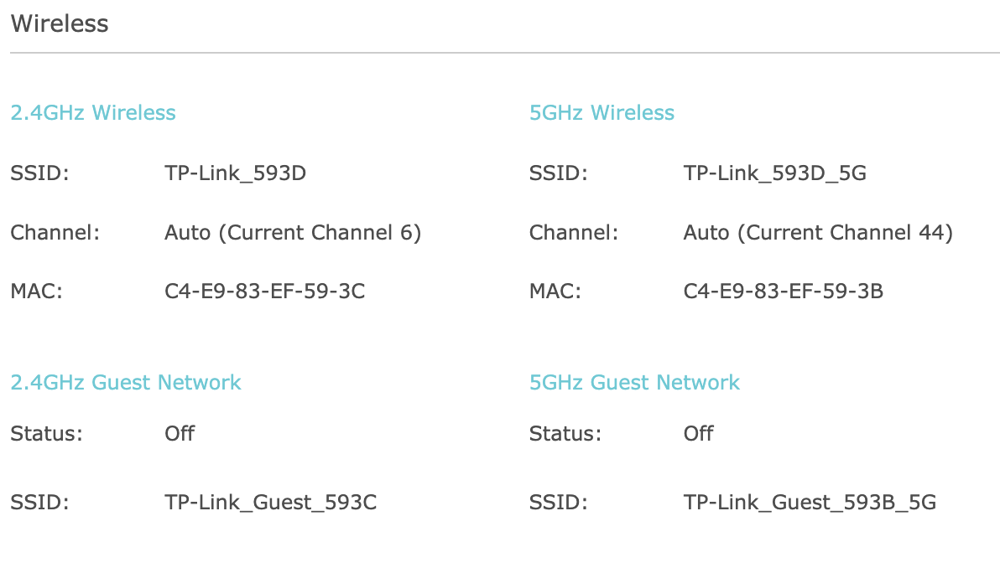

# IS355: Tutorial 6 - Wireless Networks

## Table of Contents

- [Task 1: View Wi-Fi Details](#task-1-view-wi-fi-details)
- [Task 2: Use Wi-Fi Access Point](#task-2-use-wi-fi-access-point)
- [Task 3: Continue Your Project](#task-3-continue-your-project)

---

## Task 1: View Wi-Fi Details

### Overview & Inspection
Wireless networks use radio frequencies to allow devices to communicate with Wireless Access Points (APs) without requiring physical Ethernet connections. Each access point broadcasts a Service Set Identifier (SSID), allowing nearby devices to identify and connect to the network.

Wi-Fi networks commonly operate on the **2.4 GHz, 5 GHz, and 6 GHz frequency bands**, depending on the wireless standard and device capabilities.

### Wi-Fi Inspection Commands

On a Windows computer, PowerShell can be used to examine wireless connections using the following commands:

```powershell
Install-Module WiFiTools
Show-WiFiState
Scan-WiFiAPs
Show-WiFiInterface
Get-WiFiLog | Select-Object -First 10
```

Alternatively, Windows provides the following built-in command:

```powershell
netsh wlan show interfaces
```

On macOS, holding the **Option (⌥)** key while clicking the Wi-Fi icon displays connection information, including the SSID, BSSID, channel, and transmission rate.

### Wireless Access Point Information

| Property | Access Point 1 |
| :--- | :--- |
| **SSID** | [Enter Network Name] |
| **BSSID** | [Enter MAC Address] |
| **Frequency Band** | [2.4 GHz / 5 GHz / 6 GHz] |
| **Channel** | [Enter Channel Number] |
| **Data Rate (Tx Rate)** | [Enter Mbps] |

### Understanding Wireless Network Properties

* **SSID (Service Set Identifier):** The name assigned to a wireless network, allowing users to identify available networks.
* **BSSID (Basic Service Set Identifier):** The MAC address identifying a particular wireless access point or radio interface.
* **Frequency Band:** Determines the radio frequency range used for communication. The 2.4 GHz band generally offers greater range, while 5 GHz and 6 GHz can provide higher speeds and additional capacity.
* **Wireless Channel:** A specific section of the frequency spectrum used by an access point. Overlapping channels can introduce interference and reduce network performance.
* **Data Rate:** The negotiated wireless transmission speed between the device and access point, typically measured in megabits per second (Mbps). This differs from actual internet throughput.

### Observations & Analysis

The information provided by wireless network inspection tools is important for understanding network performance and identifying potential connectivity problems.

A device connected to a crowded 2.4 GHz channel may experience more interference than one connected to a less congested 5 GHz channel. Similarly, the distance between a device and its access point, physical obstructions, and wireless signal strength can affect connection speeds.

Analyzing SSIDs, BSSIDs, channels, and data rates helps network administrators identify interference, evaluate wireless coverage, and optimize access point placement.

---

## Task 2: Use Wi-Fi Access Point

### Overview & Configuration

Wireless Access Points provide connectivity between wireless devices and a wired network. Their management interfaces allow administrators to configure wireless security, frequency bands, network identifiers, authentication methods, and access restrictions.

The TP-Link router emulator provides an alternative method of exploring wireless configuration settings without requiring access to a physical router.

**TP-Link Emulator:** https://www.tp-link.com/au/support/emulator/

Example router models include the **TP-Link Archer C6** and **TL-WR841N**.

### Important Wireless Access Point Settings

| Setting | Recommended Configuration | Security / Performance Consideration |
| :--- | :--- | :--- |
| **SSID** | Unique, recognizable network name | Identifies the network without revealing sensitive information |
| **Wireless Security** | WPA3-Personal or WPA2-AES | Protects wireless communication through encryption and authentication |
| **Wi-Fi Password** | Strong, unique password | Prevents unauthorized users from accessing the network |
| **Frequency Band** | 5 GHz preferred for capable devices; 2.4 GHz when needed | Balances connection speed, range, and compatibility |
| **Wireless Channel** | Select channels with minimal interference | Reduces congestion and improves connection stability |
| **Channel Width** | 20 MHz on 2.4 GHz; 40/80 MHz on 5 GHz as appropriate | Balances throughput and interference |
| **Guest Network** | Enable with internal network isolation | Allows visitor internet access without exposing internal resources |
| **WPS** | Disabled | Reduces unnecessary wireless connection vulnerabilities |
| **Administrative Access** | Unique credentials and restricted management access | Prevents unauthorized router configuration changes |
| **Firmware Updates** | Latest supported stable firmware | Addresses security vulnerabilities and improves reliability |

### Recommended Configuration Changes

#### 1. Wireless Security & Authentication
The wireless network should use **WPA3-Personal** when supported or **WPA2-AES** for compatibility with older devices. Outdated security protocols such as WEP and WPA using TKIP should be avoided because they contain known security weaknesses.

For enterprise environments, WPA3-Enterprise or WPA2-Enterprise with centralized authentication may be more appropriate than a shared wireless password.

#### 2. Frequency Band Selection
Devices requiring higher throughput should preferably connect using the **5 GHz band**, while 2.4 GHz can accommodate older devices and areas requiring greater signal penetration.

Access point placement should account for building construction, interference, and the number of connected devices.

#### 3. Wireless Channel Management
Wireless channels should be selected based on the surrounding wireless environment.

Within the 2.4 GHz band, **channels 1, 6, and 11** are commonly used in the United States because they avoid overlap when operating at 20 MHz channel widths.

For 5 GHz networks, channel selection should account for nearby access points, available spectrum, and regulatory restrictions.

#### 4. Guest Network Isolation
A dedicated guest wireless network should be configured to allow visitors to access the internet while preventing communication with internal company systems.

Network segmentation can be implemented through a dedicated **Guest VLAN**, firewall access control rules, and wireless client isolation.

#### 5. Administrative Security
Default router administrator credentials should be replaced with strong, unique credentials. Unnecessary remote administration features and WPS should be disabled.

Firmware should also be updated regularly to address known vulnerabilities.

### Access Point Configuration Screenshot



*Figure 1: Wireless access point management interface showing configurable network settings.*

### Security & Performance Analysis

Proper access point configuration is essential for maintaining a secure and reliable wireless network.

Wireless encryption protects transmitted information, while authentication controls which users and devices can connect. Channel planning and frequency selection reduce interference and improve overall network performance.

Separating guest and employee wireless traffic further protects internal resources by restricting unnecessary communication between different network segments.

---

## Task 3: Continue Your Project

### Project Overview

Our group is designing a secure network infrastructure for a company operating within a single location containing both an office environment and a factory floor.

The proposed infrastructure includes:

* **Office Network:** Employee workstations, printers, and business systems.
* **Factory Network:** Industrial equipment, including Programmable Logic Controllers (PLCs), Human-Machine Interfaces (HMIs), and factory workstations.
* **Wireless Network:** Secure connectivity for authorized employees and visitors.
* **Security Camera Network:** IP cameras connected to an on-site Network Video Recorder (NVR).
* **Network Management:** Centralized administration, monitoring, and security configuration.

The network design uses **VLAN segmentation, firewall restrictions, and access controls** to separate different device categories and reduce unnecessary network exposure.

### a) Proposed VLAN Segmentation

| VLAN ID | Network Segment | Purpose | Security Requirements |
| :--- | :--- | :--- | :--- |
| **VLAN 10** | Office Network | Employee workstations and business applications | Authorized access to business resources |
| **VLAN 20** | Factory Network | PLCs, HMIs, and industrial equipment | Restricted communication with office and external networks |
| **VLAN 30** | Security Cameras | IP cameras and Network Video Recorder | Access limited to authorized monitoring systems |
| **VLAN 40** | Guest Wi-Fi | Visitor wireless connectivity | Internet-only access with internal network isolation |
| **VLAN 50** | Network Management | Switches, routers, firewalls, and AP management | Restricted administrative access |

*Note: VLAN assignments are proposed and should be verified against the group's final network design.*

### b) Wireless Network Integration

#### Employee Wireless Network
A dedicated employee SSID should provide secure wireless access for authorized company personnel.

Employee devices should use strong authentication and encryption. Wireless traffic would be assigned to an appropriate internal network segment, with access controlled by firewall policies.

#### Guest Wireless Network
A separate guest SSID should be mapped to **VLAN 40**, allowing visitors to access the internet without reaching office workstations, factory equipment, or security cameras.

Guest network restrictions should include:

* Blocking access to internal private network resources.
* Enabling wireless client isolation where appropriate.
* Restricting unnecessary services and communication ports.
* Applying firewall rules to separate guest traffic from internal systems.

#### Factory Wireless Considerations
The factory environment introduces additional wireless challenges because large machinery, metal structures, and industrial equipment can interfere with radio signals.

Access points should be positioned based on wireless coverage requirements and the physical layout of the building.

Industrial systems such as PLCs and HMIs should remain isolated from general-purpose wireless networks. Wireless access to industrial equipment should only be enabled when operationally required and explicitly authorized.

### c) Wireless Security Architecture

The proposed wireless design incorporates several important security controls:

1. **Authentication:** Require authorized credentials before granting wireless network access.
2. **Encryption:** Use WPA3 or WPA2-AES to protect wireless communications.
3. **Network Segmentation:** Separate employee, guest, factory, camera, and management traffic using VLANs.
4. **Firewall Policies:** Restrict communication between network segments based on operational requirements.
5. **Access Point Management:** Limit administrative access to authorized personnel.
6. **Firmware Maintenance:** Keep wireless infrastructure updated to reduce exposure to known vulnerabilities.
7. **Network Monitoring:** Monitor wireless activity, connected devices, and potential unauthorized access attempts.

These measures support the project's broader security approach based on **NIST SP 800-53** and the **Essential Eight** cybersecurity framework.

### d) Project Development & Next Steps

The concepts covered in Tutorial 6 help establish the wireless networking requirements for the group's proposed network design.

The following items should be addressed before finalizing the design:

* Confirm the number and locations of required wireless access points.
* Verify VLAN assignments and corresponding IP addressing plans.
* Determine how employee and guest SSIDs will map to network VLANs.
* Establish firewall rules between office, factory, security camera, guest, and management networks.
* Evaluate wireless coverage and potential interference throughout the office and factory environment.
* Incorporate wireless infrastructure into the overall network topology diagram.
* Seek feedback from the professor regarding wireless segmentation and network security decisions.

### Project Security Considerations

The separation of office, industrial, security, and guest networks reduces the potential impact of unauthorized access or compromised devices.

For example, a visitor connected to the guest Wi-Fi should not be able to access industrial control equipment or security camera recordings.

Similarly, industrial devices should communicate only with the systems necessary for manufacturing operations.

This approach follows the principles of **least privilege, defense in depth, and network segmentation**, which are important components of secure enterprise network design.

---

## Conclusion

Tutorial 6 explored the fundamental components of wireless networking, including SSIDs, BSSIDs, frequency bands, wireless channels, transmission rates, and access point configuration.

Understanding these properties is important for identifying wireless connectivity issues and developing networks that balance speed, coverage, reliability, and security.

The tutorial also demonstrated how wireless network security settings, guest isolation, and VLAN segmentation can be incorporated into our factory-and-office network project.

Applying these concepts will help our group develop a secure, organized, and scalable network infrastructure.

