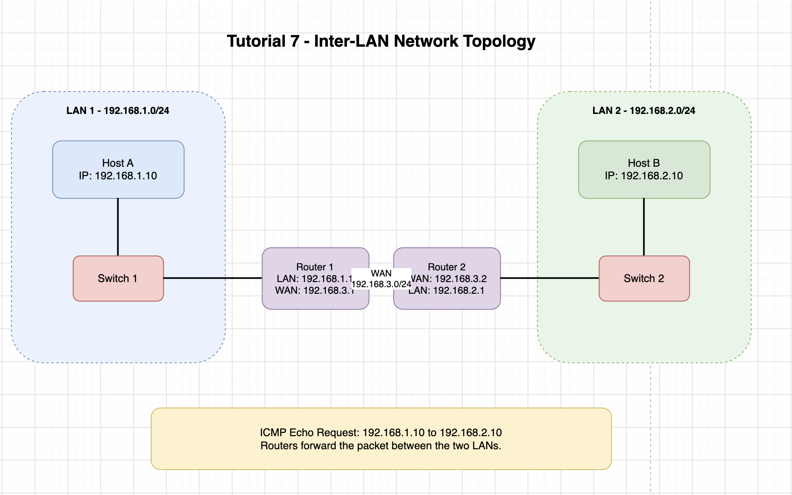
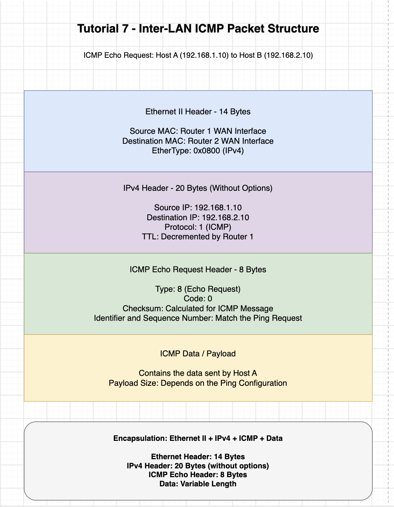

# IS355: Tutorial 7 - Azure Cloud Computing and Packet Analysis

## Table of Contents

- [Part 1: Azure Cloud Computing](#part-1-azure-cloud-computing)
- [Task 1: Analyze Ping Packet Capture](#task-1-analyze-ping-packet-capture)
- [Task 2: Analyzing HTTP Packet Capture](#task-2-analyzing-http-packet-capture)
- [Task 3: Packet Structure (Optional)](#task-3-packet-structure-optional)
- [Tasks 4 and 5: Additional Resources (Optional)](#tasks-4-and-5-additional-resources-optional)
- [Conclusion](#conclusion)

---

## Part 1: Azure Cloud Computing

### Introduction to Cloud Infrastructure

Cloud computing allows organizations to access computing resources over the internet rather than owning and managing every physical server. Microsoft Azure provides virtual machines, networks, storage, databases, security tools, and monitoring services.

The three main cloud service models are:

- **Infrastructure as a Service (IaaS):** Customers manage virtual machines, operating systems, and applications while the provider maintains physical infrastructure.
- **Platform as a Service (PaaS):** Customers build and deploy applications without managing most underlying infrastructure.
- **Software as a Service (SaaS):** Users access complete applications managed by the provider.

Cloud infrastructure can be scaled when demand changes, but administrators must understand costs and the shared responsibility for security.

### Important Azure Services

| Azure Service | Main Purpose |
| :--- | :--- |
| **Azure Virtual Machines** | Run Windows or Linux computers in the cloud |
| **Azure Virtual Network (VNet)** | Connect and segment Azure resources |
| **Network Security Groups (NSGs)** | Filter permitted inbound and outbound network traffic |
| **Azure Storage** | Store data such as files, objects, and disks |
| **Resource Groups** | Organize related Azure resources for management |
| **Azure Key Vault** | Safeguard secrets, keys, and certificates |
| **Azure Monitor** | Collect monitoring data, logs, and metrics |

### Azure Virtual Machine Setup (Optional)

The Microsoft Learn VM quickstart describes creating a Windows virtual machine through the Azure portal. The general steps are to select a resource group, region, operating system image, VM size, authentication method, network settings, and access rules, then review the configuration before deployment.

A VM may be used to host a web server. Network access must be limited to required ports and trusted sources, and storage resources can be attached or managed separately. **No live Azure VM or other paid Azure resource was created for this tutorial.**

Reference: [Create a Windows VM in the Azure portal](https://learn.microsoft.com/en-us/azure/virtual-machines/windows/quick-create-portal)

### Microsoft Learn Resource Review

I reviewed the topics presented in the Microsoft Learn materials about Azure virtual networks, storage security, Applied Skills, and Azure Fundamentals.

**Observation 1 - Virtual networking:** A VNet provides a private networking environment for Azure resources. Subnets organize the network, and NSGs apply traffic rules. These concepts are similar to IP subnetting and access control lists in a local enterprise network.

**Observation 2 - Storage security:** Azure storage must be protected using secure connections, authentication, and appropriate permissions. Encryption alone does not replace access control; users and services should receive only the access they need.

**Observation 3 - Cloud credentials:** Microsoft Applied Skills credentials focus on demonstrated tasks and lab-based assessments, while Azure Fundamentals (AZ-900) is a broader entry-level certification exam covering cloud concepts and Azure services.

### Resources

- [AZ-104: Configure and Manage Virtual Networks](https://learn.microsoft.com/en-us/training/paths/az-104-manage-virtual-networks/)
- [Implement Security and Manage Access for Azure Storage](https://learn.microsoft.com/en-us/training/modules/implement-storage-account-security/)
- [Microsoft Applied Skills](https://learn.microsoft.com/en-us/credentials/applied-skills/)
- [Microsoft Learn - Azure Fundamentals (AZ-900)](https://learn.microsoft.com/en-us/credentials/certifications/azure-fundamentals/)

### Connection to IS355

Azure uses many concepts covered in IS355, including subnetting, routing, authentication, access controls, and monitoring. Whether a service runs on a local server or in Azure, it needs secure network access and appropriate protection of sensitive information.

---

## Task 1: Analyze Ping Packet Capture

### Overview & Inspection

I analyzed the provided `arp (1).pcap` file to examine how **ARP** resolves local IPv4 addresses into MAC addresses and how **ICMP** supports connectivity testing through ping. The file includes ARP requests and ICMP Echo Request/Reply packets.

### a) Devices and Addresses

The following address pairs were identified in the capture:

| Device | IPv4 Address | MAC Address |
| :--- | :--- | :--- |
| **Device A** | `192.168.1.1` | `08:00:27:5e:01:7c` |
| **Device B** | `192.168.1.104` | `08:00:27:b8:b7:58` |
| **Device C** | `192.168.1.105` | `08:00:27:2d:f8:5a` |

### b) Network Diagram

*Figure 1: Logical network diagram showing the addresses observed in the packet capture. The physical switch arrangement cannot be determined from the packets alone.*

**Editable source:** [`Tutorial7Network.drawio`](IM/Tutorial7Network.drawio)

### c) Purpose of ARP Packets

An ARP request is used when a device knows the destination IPv4 address on its local network but needs the corresponding Ethernet MAC address.

The first ARP request appears as **packet 11**:

| Field | Observed Value |
| :--- | :--- |
| **Operation** | Request (1) |
| **Sender IPv4** | `192.168.1.1` |
| **Sender MAC** | `08:00:27:5e:01:7c` |
| **Target IPv4** | `192.168.1.105` |
| **Target MAC in request** | `00:00:00:00:00:00` (unknown) |
| **Ethernet Destination** | `ff:ff:ff:ff:ff:ff` (broadcast) |

The device at `192.168.1.1` broadcast its request to all devices in the local broadcast domain because it did not yet know the MAC address for `192.168.1.105`.

### d) First ARP Packet: Encapsulation

| Component | Size |
| :--- | ---: |
| Ethernet II header | 14 bytes |
| ARP message | 28 bytes |
| **Total captured length** | **42 bytes** |

*Figure 2: Ethernet II encapsulation of the first ARP request, including header fields and byte lengths.*

**Editable source:** [`Tutorial7ARP.drawio`](IM/Tutorial7ARP.drawio)

The capture does not include an Ethernet Frame Check Sequence (FCS). No padding bytes are present in this captured packet.

### e) First Two ICMP Packets

The first two ICMP packets form an Echo Request/Reply exchange:

| Property | Packet 34: Echo Request | Packet 37: Echo Reply |
| :--- | :--- | :--- |
| **Source IPv4** | `192.168.1.1` | `192.168.1.104` |
| **Destination IPv4** | `192.168.1.104` | `192.168.1.1` |
| **ICMP Type** | 8 (Echo Request) | 0 (Echo Reply) |
| **ICMP Code** | 0 | 0 |
| **Captured Length** | 62 bytes | 62 bytes |

Packet 34 tests whether `192.168.1.104` can be reached. Packet 37 is the response, demonstrating successful ICMP communication in both directions.

### f) First ICMP Packet: Encapsulation

| Component | Size |
| :--- | ---: |
| Ethernet II header | 14 bytes |
| IPv4 header | 20 bytes |
| ICMP Echo header | 8 bytes |
| ICMP payload | 20 bytes |
| **Total captured length** | **62 bytes** |

*Figure 3: Encapsulation of packet 34: Ethernet frame, IPv4 header, ICMP Echo header, and payload.*

**Editable source:** [`Tutorial7ICMP.drawio`](IM/Tutorial7ICMP.drawio)

### Observations & Analysis

ARP provides the link-layer address required for local Ethernet delivery, while ICMP supports testing whether devices can exchange IP packets. The successful Echo Reply demonstrates connectivity between the two observed IPv4 endpoints.

---

## Task 2: Analyzing HTTP Packet Capture

### Overview & Inspection

I analyzed `Sample 7 (3).pcap` to identify the **TCP three-way handshake** and the first HTTP application-data packet. The file contains 40 packets in a connection between `192.168.1.2` and `174.143.213.184` using TCP port 80.

### Initial SYN Packet

**1. What packet number is the first SYN?**  
**Packet 1.**

**2. What are the source and destination IP addresses?**  
Source: `192.168.1.2`  
Destination: `174.143.213.184`

**3. What source and destination ports are used?**  
Source port: `54841`  
Destination port: `80` (HTTP)

**4. What is the raw sequence number?**  
`4129057982`

### SYN-ACK Response

**5. What packet number is the SYN-ACK response?**  
**Packet 2.**

**6. What flags are set?**  
**SYN** and **ACK**.

**7. What are the server's raw sequence and acknowledgment numbers?**  
Raw sequence number: `4200111240`  
Raw acknowledgment number: `4129057983`

**8. Why is the acknowledgment number what it is?**  
A SYN consumes one TCP sequence number, so the server acknowledges the client's initial sequence number plus one: `4129057982 + 1 = 4129057983`.

### Final ACK

**9. What packet number is the final ACK?**  
**Packet 3.**

**10. What flags are set?**  
**ACK**.

**11. What raw acknowledgment number is returned?**  
`4200111241`. This acknowledges the server's SYN, which also consumes one sequence number.

### First Application Data

**12. Which packet first contains application data, and what flags are set?**  
**Packet 4**, with **PSH** and **ACK** set. It carries the request `GET /images/layout/logo.png HTTP/1.1` to `packetlife.net`.

- **PSH (Push):** Requests prompt delivery of received TCP data to the application.
- **ACK (Acknowledgment):** Indicates that the acknowledgment number is valid and acknowledges data received from the other endpoint.

### TCP Connection Summary

| Packet | Source | Destination | TCP Flags | Purpose |
| :--- | :--- | :--- | :--- | :--- |
| **1** | Client | Server | SYN | Requests a connection |
| **2** | Server | Client | SYN, ACK | Acknowledges and responds to the request |
| **3** | Client | Server | ACK | Completes the handshake |
| **4** | Client | Server | PSH, ACK | Sends the HTTP GET request |

### Observations & Analysis

The three-way handshake coordinates the initial sequence numbers used by both devices before application data is exchanged. After the handshake, packet 4 carries the first HTTP request. The server later responds with `HTTP/1.1 200 OK` and transfers the requested image.

---

## Task 3: Packet Structure (Optional)

### Inter-LAN Packet Forwarding Example

This optional example reuses the two-LAN addressing scheme from Tutorial 5. **It is an illustrative network, not a topology discovered in the Tutorial 7 PCAP.**

| Device | Interface | IPv4 Address |
| :--- | :--- | :--- |
| Host A | LAN 1 NIC | `192.168.1.10` |
| Router 1 | LAN interface | `192.168.1.1` |
| Router 1 | WAN interface | `192.168.3.1` |
| Router 2 | WAN interface | `192.168.3.2` |
| Router 2 | LAN interface | `192.168.2.1` |
| Host B | LAN 2 NIC | `192.168.2.10` |

### a) Network Diagram

### b) Routing Tables

**Router 1**

| Destination Network | Next Hop |
| :--- | :--- |
| `192.168.1.0/24` | Directly connected |
| `192.168.3.0/24` | Directly connected |
| `192.168.2.0/24` | `192.168.3.2` |

**Router 2**

| Destination Network | Next Hop |
| :--- | :--- |
| `192.168.2.0/24` | Directly connected |
| `192.168.3.0/24` | Directly connected |
| `192.168.1.0/24` | `192.168.3.1` |

### c) ICMP Packet on the Inter-Router Link

When Host A pings Host B, the IPv4 packet contains:

- **Source IPv4:** `192.168.1.10`
- **Destination IPv4:** `192.168.2.10`
- **Protocol:** ICMP
- **ICMP Type:** 8 (Echo Request)

On an **Ethernet-based link** between Router 1 and Router 2, the Ethernet frame would have Router 1's outgoing-interface MAC as its source and Router 2's receiving-interface MAC as its destination. The host IPv4 source and destination remain unchanged during ordinary routing; MAC addresses are rewritten at each Ethernet hop. Other WAN link types use different link-layer encapsulation.

---

## Tasks 4 and 5: Additional Resources (Optional)

### Malware Traffic Analysis

I reviewed the Malware-Traffic-Analysis.net resources listed in the tutorial. They provide packet-capture exercises and examples of suspicious network activity for practice with tools such as Wireshark.

Interesting points:

- Packet captures can reveal patterns in DNS requests, HTTP traffic, and connections that may warrant security investigation.
- Practice PCAP files help connect basic protocol knowledge with real cybersecurity analysis.
- The site's exercises provide examples beyond ordinary ARP, ICMP, and TCP connectivity checks.

Resources:

- [Malware Traffic Analysis](https://www.malware-traffic-analysis.net/index.html)
- [Training Exercises](https://www.malware-traffic-analysis.net/training-exercises.html)
- [Malware Traffic Analysis on Bluesky](https://bsky.app/profile/malware-traffic-analysis.net)

---

## Conclusion

Tutorial 7 connected cloud computing concepts with practical network traffic analysis. In the Azure portion, I reviewed virtual networks, storage security, monitoring tools, and Microsoft's entry-level credentials. In Wireshark, I studied how ARP discovers MAC addresses, how ICMP verifies connectivity, and how TCP establishes a reliable connection before HTTP data transfer begins.

The packet diagrams and addressing tables made the relationship between Ethernet framing, IP addressing, and transport/application protocols easier to understand. These concepts are useful when troubleshooting networks and designing secure local or cloud infrastructure.
