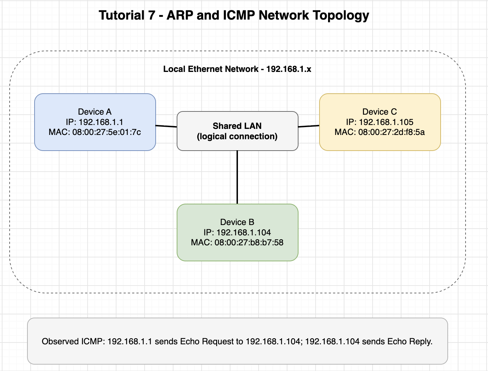
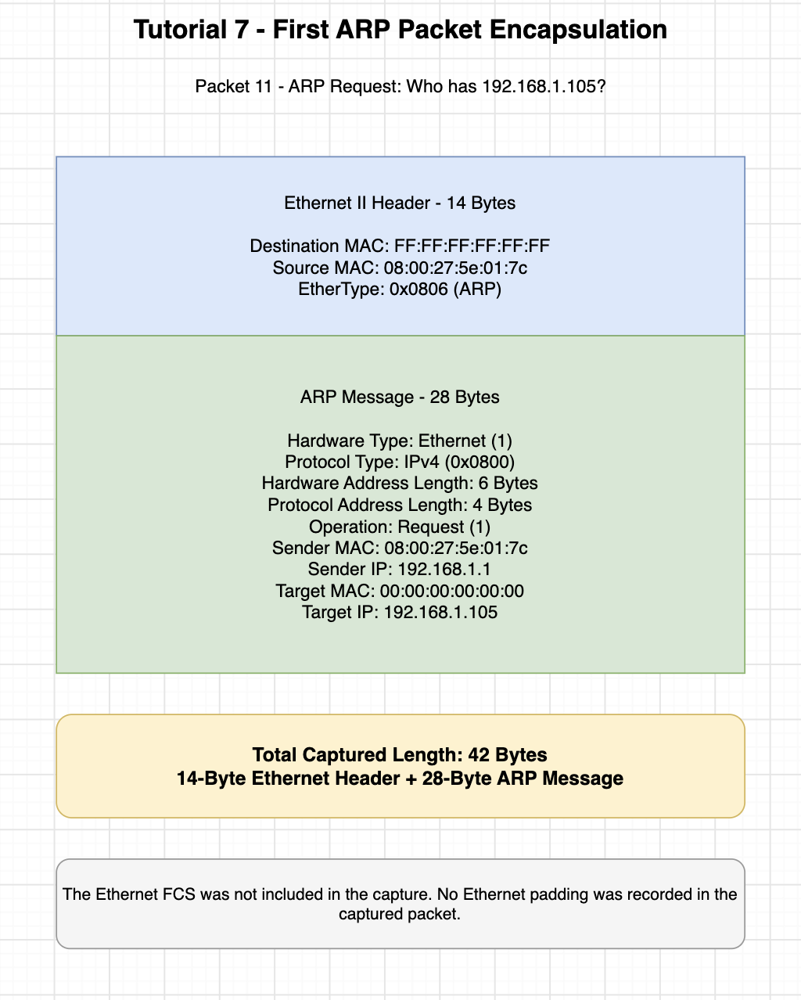
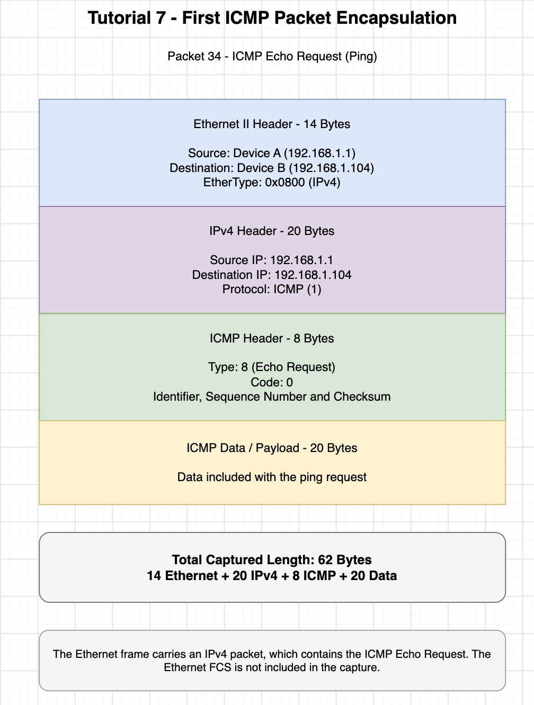

# IS355: Tutorial 7 - Azure Cloud Computing and Packet Analysis

## Table of Contents

- [Part 1: Azure Cloud Computing](#part-1-azure-cloud-computing)
- [Task 1: Analyze Ping Packet Capture](#task-1-analyze-ping-packet-capture)
- [Task 2: Analyzing HTTP Packet Capture](#task-2-analyzing-http-packet-capture)
- [Task 3: Packet Structure (Optional)](#task-3-packet-structure-optional)
- [Task 4 & 5: Additional Resources (Optional)](#task-4--5-additional-resources-optional)
- [Conclusion](#conclusion)

---

## Part 1: Azure Cloud Computing

### Introduction to Cloud Infrastructure

Cloud computing allows organizations to access computing resources, such as virtual machines, storage, databases, and networking services, over the internet without maintaining all the physical infrastructure themselves.

Microsoft Azure is a cloud computing platform that provides infrastructure, applications, storage, and security services.

### Cloud Service Models

* **Infrastructure as a Service (IaaS):** Provides virtual machines, storage, and networking infrastructure that customers can configure and manage.
* **Platform as a Service (PaaS):** Provides managed environments for developing and deploying applications without managing the underlying servers.
* **Software as a Service (SaaS):** Provides ready-to-use applications hosted by a cloud provider and accessed over the internet.

### Important Cloud Computing Concepts

* **Scalability:** Cloud resources can be increased or decreased based on demand.
* **Availability:** Cloud services can use redundancy and multiple locations to improve reliability.
* **Virtualization:** Multiple virtual machines can operate on shared physical infrastructure.
* **Pay-as-you-go Pricing:** Customers generally pay based on the resources and services they use.
* **Shared Responsibility:** Security responsibilities are divided between the cloud provider and the customer, depending on the service model.

### Azure Services

| Azure Service | Purpose |
| :--- | :--- |
| **Azure Virtual Machines** | Runs virtual computers in the cloud |
| **Azure Virtual Network** | Provides private networking for Azure resources |
| **Azure Storage** | Stores files, objects, and other data |
| **Azure Resource Groups** | Organizes related cloud resources |
| **Azure Key Vault** | Protects secrets, encryption keys, and certificates |
| **Azure Monitor** | Collects monitoring information and performance metrics |
| **Azure Firewall** | Provides managed network traffic filtering |

### Azure Virtual Machine Configuration

Microsoft Azure allows users to create Windows and Linux virtual machines through the Azure Portal.

The basic process involves:

1. Sign in to the Azure Portal.
2. Create or select a resource group.
3. Configure a virtual machine name and region.
4. Select an operating system and VM size.
5. Configure administrator authentication.
6. Configure virtual networking and access restrictions.
7. Review the deployment settings and create the resource.

Virtual machines can be used to host applications, web servers, development environments, and business services.

**Azure Portal:** https://portal.azure.com/

**Microsoft Learn VM Tutorial:**
https://learn.microsoft.com/en-us/azure/virtual-machines/windows/quick-create-portal

*Note: Creating a live Azure virtual machine is optional for this tutorial and has not been documented as completed.*

### Microsoft Learn Resources

The tutorial identifies several Microsoft Learn resources covering cloud infrastructure, virtual networking, and security.

**1. Azure Virtual Networking**

Azure Virtual Networks allow cloud resources to communicate securely with each other and with external networks.

Important components include:

* Virtual networks and subnets.
* Network Security Groups (NSGs).
* IP addressing and routing.
* Virtual network peering.
* Private and public network connectivity.

https://learn.microsoft.com/en-us/training/paths/az-104-manage-virtual-networks/

**2. Azure Storage Security**

Azure Storage security includes access controls, encryption, and authentication mechanisms designed to protect cloud-hosted data.

Important considerations include:

* Restricting unauthorized storage access.
* Using role-based access control.
* Protecting stored information through encryption.
* Limiting unnecessary public network exposure.

https://learn.microsoft.com/en-us/training/modules/implement-storageaccount-security/

**3. Microsoft Applied Skills**

Microsoft Applied Skills credentials evaluate specific technical skills through practical assessments.

https://learn.microsoft.com/en-us/credentials/applied-skills/

**4. Azure Fundamentals (AZ-900)**

AZ-900 is an entry-level Microsoft certification covering basic cloud concepts, Azure architecture, services, security, and management.

Unlike Microsoft Applied Skills credentials, AZ-900 requires passing a certification examination.

### Azure and Network Security

Cloud computing introduces additional security considerations because resources may be accessible through public networks.

Organizations should implement appropriate authentication, firewall rules, network segmentation, encryption, and monitoring.

These controls help protect cloud infrastructure and prevent unauthorized access to business information.

---

## Task 1: Analyze Ping Packet Capture

### Overview & Inspection

I examined the provided ARP packet capture using Wireshark to understand how ARP and ICMP operate within a local network.

ARP (Address Resolution Protocol) resolves IPv4 addresses into MAC addresses, while ICMP (Internet Control Message Protocol) supports network diagnostics, including ping requests and replies.

### a) Network Devices and Addresses

The following devices were identified in the packet capture.

| Device | IPv4 Address | MAC Address |
| :--- | :--- | :--- |
| **Device A** | `192.168.1.1` | `08:00:27:5e:01:7c` |
| **Device B** | `192.168.1.104` | `08:00:27:b8:b7:58` |
| **Device C** | `192.168.1.105` | `08:00:27:2d:f8:5a` |

### b) Network Diagram

*Figure 1: Logical network topology showing identified devices, IP addresses, and MAC addresses.*

The diagram represents the devices communicating on the local Ethernet network. The exact physical switch topology cannot be determined from the capture alone.

### c) Purpose of ARP Packets

ARP allows devices to identify the MAC address associated with a particular IPv4 address on the local network.

The first ARP packet examined was **Packet 11**.

| Property | Value |
| :--- | :--- |
| **Sender IP** | `192.168.1.1` |
| **Sender MAC** | `08:00:27:5e:01:7c` |
| **Target IP** | `192.168.1.105` |
| **Destination MAC** | `ff:ff:ff:ff:ff:ff` |
| **Protocol** | ARP Request |

Device A broadcast an ARP request to determine the MAC address associated with `192.168.1.105`.

The request was sent to the broadcast MAC address so devices on the local network could receive it.

### d) First ARP Packet Structure

The first ARP packet contains an Ethernet II header followed by an ARP message.

| Packet Component | Size |
| :--- | :--- |
| **Ethernet II Header** | 14 bytes |
| **ARP Message** | 28 bytes |
| **Total Captured Length** | 42 bytes |

*Figure 2: First ARP packet showing Ethernet encapsulation, addressing, and byte sizes.*

The Ethernet header identifies the source and destination MAC addresses, while the ARP message contains the sender and target network addresses.

The Ethernet Frame Check Sequence (FCS) was not included in the captured packet.

### e) First Two ICMP Packets

ICMP is used to exchange network diagnostic and control information.

The first two ICMP packets represent a ping request and its corresponding reply.

#### Packet 34 - ICMP Echo Request

| Property | Value |
| :--- | :--- |
| **Packet Number** | 34 |
| **Source IP** | `192.168.1.1` |
| **Destination IP** | `192.168.1.104` |
| **ICMP Type** | 8 (Echo Request) |
| **ICMP Code** | 0 |
| **Captured Length** | 62 bytes |

Device A sent an ICMP Echo Request to Device B to test whether the destination device was reachable.

#### Packet 37 - ICMP Echo Reply

| Property | Value |
| :--- | :--- |
| **Packet Number** | 37 |
| **Source IP** | `192.168.1.104` |
| **Destination IP** | `192.168.1.1` |
| **ICMP Type** | 0 (Echo Reply) |
| **ICMP Code** | 0 |
| **Captured Length** | 62 bytes |

Device B responded with an ICMP Echo Reply, confirming that the request reached the destination and that a reply could return to the original sender.

### f) First ICMP Packet Structure

An ICMP Echo Request is encapsulated within an IPv4 packet, which is then carried inside an Ethernet frame.

| Packet Component | Size |
| :--- | :--- |
| **Ethernet II Header** | 14 bytes |
| **IPv4 Header** | 20 bytes |
| **ICMP Header** | 8 bytes |
| **ICMP Data** | 20 bytes |
| **Total Captured Length** | 62 bytes |

*Figure 3: First ICMP Echo Request showing Ethernet, IPv4, and ICMP encapsulation.*

### Observations & Analysis

The packet capture demonstrates how ARP and ICMP support communication on a local network.

ARP determines the MAC addresses needed for local delivery, while ICMP allows devices to test connectivity using Echo Request and Echo Reply messages.

The successful ping exchange between `192.168.1.1` and `192.168.1.104` confirms that the devices were able to communicate using ICMP.

---

## Task 2: Analyzing HTTP Packet Capture

### Overview & Inspection

I analyzed the provided HTTP packet capture using Wireshark to understand the TCP three-way handshake and how TCP establishes reliable communication before application data is transferred.

The capture contains 40 packets showing TCP connection establishment, HTTP data transfer, and connection termination.

### TCP Three-Way Handshake

#### Initial SYN Packet

**1. What packet number is the first SYN?**

The first SYN is **Packet 1**.

**2. What are the source and destination IP addresses?**

* Source IP: `192.168.1.2`
* Destination IP: `174.143.213.184`

**3. What source and destination ports are used?**

* Source Port: `54841`
* Destination Port: `80` (HTTP)

**4. What is the raw sequence number?**

`4129057982`

#### SYN-ACK Response

**5. What packet number is the SYN-ACK response?**

The SYN-ACK response is **Packet 2**.

**6. What flags are set?**

The **SYN** and **ACK** flags are set.

**7. What are the server's raw sequence and acknowledgment numbers?**

* Raw Sequence Number: `4200111240`
* Raw Acknowledgment Number: `4129057983`

**8. Why is the acknowledgment number what it is?**

The server acknowledges the client's initial sequence number plus one.

The SYN flag consumes one TCP sequence number, so the acknowledgment number is:

`4129057982 + 1 = 4129057983`

#### Final ACK Response

**9. What packet number is the final ACK?**

The final ACK is **Packet 3**.

**10. What flags are set?**

The **ACK** flag is set.

**11. What is the raw acknowledgment number?**

`4200111241`

This acknowledges the server's initial sequence number plus one.

### Application Data Transfer

**12. Which packet is the first packet containing application data? What flags are set, and what do they mean?**

The first packet containing application data is **Packet 4**.

| Property | Value |
| :--- | :--- |
| **Packet Number** | 4 |
| **Source IP** | `192.168.1.2` |
| **Destination IP** | `174.143.213.184` |
| **Source Port** | 54841 |
| **Destination Port** | 80 |
| **TCP Flags** | PSH, ACK |
| **Application Protocol** | HTTP |
| **HTTP Request** | `GET /images/layout/logo.png HTTP/1.1` |

* **PSH (Push):** Requests that received data be delivered promptly to the receiving application.
* **ACK (Acknowledgment):** Indicates that the acknowledgment field is valid and confirms receipt of previous TCP data.

### TCP Handshake Summary

| Packet | Source | Destination | TCP Flags | Purpose |
| :--- | :--- | :--- | :--- | :--- |
| **1** | Client | Server | SYN | Initiates the TCP connection |
| **2** | Server | Client | SYN, ACK | Acknowledges the request and initiates the server side |
| **3** | Client | Server | ACK | Completes the TCP handshake |
| **4** | Client | Server | PSH, ACK | Transmits the HTTP GET request |

### Observations & Analysis

The TCP three-way handshake establishes a connection through three packets: SYN, SYN-ACK, and ACK.

Sequence and acknowledgment numbers allow the client and server to track transmitted data and confirm successful receipt.

Once the handshake is completed, the client sends an HTTP GET request to retrieve content from the server.

This activity demonstrates how TCP provides reliable, ordered communication for application protocols such as HTTP.

---

## Task 3: Packet Structure (Optional)

### Overview

When an ICMP packet travels between two different LANs, routers forward the IP packet between networks.

The IP source and destination addresses generally remain the same during normal routing, while the Ethernet source and destination MAC addresses change at each routed hop.

For example:

* **Source IP:** The original sending host.
* **Destination IP:** The final receiving host.
* **Source MAC:** The device transmitting the Ethernet frame on the current LAN.
* **Destination MAC:** The next-hop device or receiving host on that LAN.

This demonstrates the difference between Layer 2 Ethernet addressing and Layer 3 IP addressing.

**Status:** Optional packet structure activity not yet completed.

---

## Task 4 & 5: Additional Resources (Optional)

### Network Security and Malware Traffic

The tutorial provides additional resources for exploring real-world network traffic and security incidents.

**Malware Traffic Analysis:**

https://www.malware-traffic-analysis.net/index.html

This resource provides packet captures and exercises that can be used to practice identifying suspicious network activity.

**Bluesky Profile:**

https://bsky.app/profile/malware-traffic-analysis.net

These resources may be useful for further Wireshark practice and cybersecurity analysis.

---

## Conclusion

Tutorial 7 focused on cloud computing infrastructure and the analysis of network packets using Wireshark.

The Azure portion introduced cloud infrastructure, virtual machines, networking, storage, and cloud security concepts.

The ARP and ICMP packet analysis demonstrated how devices discover MAC addresses and test connectivity on a local network.

The HTTP packet analysis demonstrated how TCP establishes a connection using the three-way handshake before transmitting application data.

Together, these activities reinforce the importance of understanding networking protocols, packet encapsulation, reliable communication, and secure infrastructure design.
