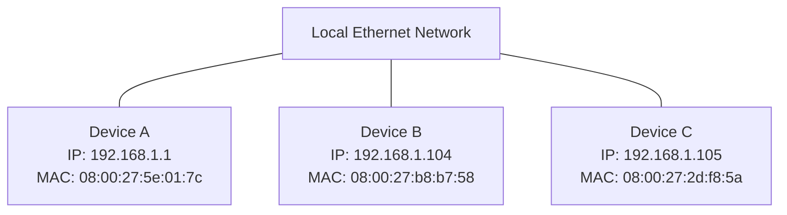

## Task 1: Analyze Ping Packet Capture

### Overview & Inspection

I examined the provided ARP packet capture to understand how ARP and ICMP support network communication.

ARP resolves IPv4 addresses into MAC addresses on a local network, while ICMP is used to send diagnostic messages such as ping requests and replies.

### a) Network Devices and Addresses

| Device | IPv4 Address | MAC Address |
| :--- | :--- | :--- |
| Device A | `192.168.1.1` | `08:00:27:5e:01:7c` |
| Device B | `192.168.1.104` | `08:00:27:b8:b7:58` |
| Device C | `192.168.1.105` | `08:00:27:2d:f8:5a` |

These addresses were identified from ARP packets in the capture.

### b) Network Diagram



The diagram represents the three identified devices on the local network. The capture does not establish the exact physical network topology.

### c) Purpose of ARP Packets

ARP (Address Resolution Protocol) allows a device to determine the MAC address associated with a known IPv4 address.

The first ARP packet was packet 11.

* **Sender IP:** `192.168.1.1`
* **Sender MAC:** `08:00:27:5e:01:7c`
* **Target IP:** `192.168.1.105`
* **Destination MAC:** `ff:ff:ff:ff:ff:ff`

Device A broadcast the ARP request to discover the MAC address associated with `192.168.1.105`.

The broadcast destination ensures that devices on the local network can receive the request.

### d) First ARP Packet Structure

Packet 11 contains an Ethernet II frame carrying an ARP request.

| Component | Size |
| :--- | :--- |
| Ethernet II Header | 14 bytes |
| ARP Message | 28 bytes |
| Total Captured Packet | 42 bytes |

```text
+-------------------------------------------+
| Ethernet II Header (14 Bytes)             |
| Destination: FF:FF:FF:FF:FF:FF             |
| Source: 08:00:27:5E:01:7C                 |
| EtherType: 0x0806 (ARP)                   |
+-------------------------------------------+
| ARP Message (28 Bytes)                    |
| Hardware Type: Ethernet                   |
| Protocol Type: IPv4                       |
| Operation: Request                        |
| Sender IP: 192.168.1.1                    |
| Target IP: 192.168.1.105                  |
+-------------------------------------------+
| Total Captured Length: 42 Bytes           |
+-------------------------------------------+
```

The capture does not include an Ethernet Frame Check Sequence (FCS). Ethernet padding is also absent from this captured frame.

### e) First Two ICMP Packets

**Packet 34 — ICMP Echo Request**

* **Source IP:** `192.168.1.1`
* **Destination IP:** `192.168.1.104`
* **ICMP Type:** 8 (Echo Request)
* **ICMP Code:** 0
* **Captured Length:** 62 bytes

Device A sent an ICMP Echo Request to Device B to test network connectivity.

**Packet 37 — ICMP Echo Reply**

* **Source IP:** `192.168.1.104`
* **Destination IP:** `192.168.1.1`
* **ICMP Type:** 0 (Echo Reply)
* **ICMP Code:** 0
* **Captured Length:** 62 bytes

Device B returned an Echo Reply, confirming that it received and responded to the request.

### f) First ICMP Packet Structure

Packet 34 is an ICMP Echo Request encapsulated inside an IPv4 packet and Ethernet frame.

| Component | Size |
| :--- | :--- |
| Ethernet II Header | 14 bytes |
| IPv4 Header | 20 bytes |
| ICMP Header | 8 bytes |
| ICMP Data | 20 bytes |
| Total Captured Packet | 62 bytes |

```text
+-------------------------------------------+
| Ethernet II Header (14 Bytes)             |
+-------------------------------------------+
| IPv4 Header (20 Bytes)                    |
| Source: 192.168.1.1                       |
| Destination: 192.168.1.104                |
| Protocol: ICMP                            |
+-------------------------------------------+
| ICMP Header (8 Bytes)                     |
| Type: 8 (Echo Request)                    |
| Code: 0                                   |
+-------------------------------------------+
| ICMP Data (20 Bytes)                      |
+-------------------------------------------+
| Total Captured Length: 62 Bytes           |
+-------------------------------------------+
```

### Observations & Analysis

The capture demonstrates how ARP and ICMP perform different functions during network communication.

ARP identifies the hardware address needed to communicate with devices on the local network.

ICMP allows devices to test connectivity using Echo Request and Echo Reply messages.

The successful response from `192.168.1.104` shows that the two devices were able to exchange ICMP messages.

## Task 2: Analyzing HTTP Packet Capture

### Overview & Inspection

I analyzed the provided HTTP packet capture to understand the TCP three-way handshake and how a connection is established before application data is transferred.

The capture contains 40 TCP packets showing the establishment of an HTTP connection, data transfer, and connection termination.

### TCP Three-Way Handshake

#### Initial SYN Packet

**1. What packet number is the first SYN?**

Packet 1.

**2. What are the source and destination IP addresses?**

* Source: `192.168.1.2`
* Destination: `174.143.213.184`

**3. What source and destination ports are used?**

* Source Port: `54841`
* Destination Port: `80` (HTTP)

**4. What is the raw sequence number?**

`4129057982`

#### SYN-ACK Response

**5. What packet number is the SYN-ACK response?**

Packet 2.

**6. What flags are set?**

SYN and ACK.

**7. What are the server's raw sequence and acknowledgment numbers?**

* Sequence Number: `4200111240`
* Acknowledgment Number: `4129057983`

**8. Why is the acknowledgment number what it is?**

The acknowledgment number is the client's original sequence number plus one.

TCP consumes one sequence number for the SYN flag, so the server acknowledges the initial sequence number plus one.

#### Final ACK Response

**9. What packet number is the final ACK?**

Packet 3.

**10. What flags are set?**

ACK.

**11. What is the raw acknowledgment number?**

`4200111241`

This acknowledges the server's initial sequence number plus one.

### Application Data Transfer

**12. Which packet first contains application data, and what flags are set?**

Packet 4 is the first packet containing application data.

* **Flags:** PSH, ACK
* **Source:** `192.168.1.2`
* **Destination:** `174.143.213.184`
* **Application Protocol:** HTTP
* **Request:** `GET /images/layout/logo.png HTTP/1.1`

The PSH flag requests prompt delivery of received data to the application.

The ACK flag acknowledges previously received TCP data.

### TCP Handshake Summary

| Packet | Source | Destination | Flags | Purpose |
| :--- | :--- | :--- | :--- | :--- |
| 1 | Client | Server | SYN | Initiates the TCP connection |
| 2 | Server | Client | SYN, ACK | Accepts connection and acknowledges client |
| 3 | Client | Server | ACK | Completes the three-way handshake |
| 4 | Client | Server | PSH, ACK | Sends the first HTTP request |

### Observations & Analysis

The TCP three-way handshake establishes a reliable connection before HTTP data is transferred.

The first packet initiates the connection, the second acknowledges the request, and the third completes the handshake.

After the connection is established, the client sends an HTTP GET request, and the server responds with the requested data.

This demonstrates how TCP uses sequence numbers, acknowledgment numbers, and control flags to maintain reliable communication.

