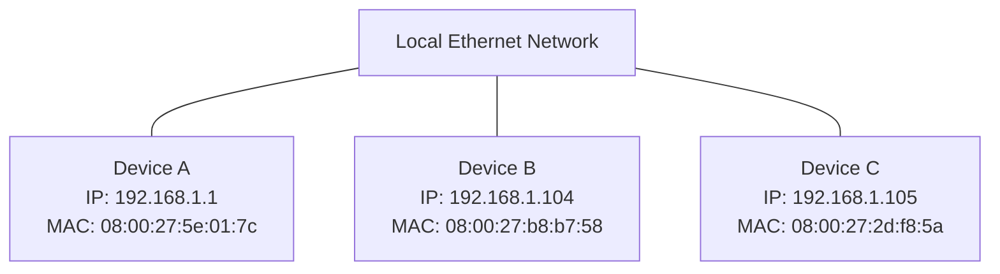

## Task 1: Analyze Ping Packet Capture

### Overview & Inspection

I examined the provided ARP packet capture to understand how ARP and ICMP support network communication.

ARP resolves IPv4 addresses into MAC addresses on a local network, while ICMP is used to send diagnostic messages such as ping requests and replies.

### a) Network Devices and Addresses

| Device | IPv4 Address | MAC Address |
| :--- | :--- | :--- |
| Device A | `192.168.1.1` | `08:00:27:5e:01:7c` |
| Device B | `192.168.1.104` | `08:00:27:b8:b7:58` |
| Device C | `192.168.1.105` | `08:00:27:2d:f8:5a` |

These addresses were identified from ARP packets in the capture.

### b) Network Diagram



The diagram represents the three identified devices on the local network. The capture does not establish the exact physical network topology.

### c) Purpose of ARP Packets

ARP (Address Resolution Protocol) allows a device to determine the MAC address associated with a known IPv4 address.

The first ARP packet was packet 11.

* **Sender IP:** `192.168.1.1`
* **Sender MAC:** `08:00:27:5e:01:7c`
* **Target IP:** `192.168.1.105`
* **Destination MAC:** `ff:ff:ff:ff:ff:ff`

Device A broadcast the ARP request to discover the MAC address associated with `192.168.1.105`.

The broadcast destination ensures that devices on the local network can receive the request.

### d) First ARP Packet Structure

Packet 11 contains an Ethernet II frame carrying an ARP request.

| Component | Size |
| :--- | :--- |
| Ethernet II Header | 14 bytes |
| ARP Message | 28 bytes |
| Total Captured Packet | 42 bytes |

```text
+-------------------------------------------+
| Ethernet II Header (14 Bytes)             |
| Destination: FF:FF:FF:FF:FF:FF             |
| Source: 08:00:27:5E:01:7C                 |
| EtherType: 0x0806 (ARP)                   |
+-------------------------------------------+
| ARP Message (28 Bytes)                    |
| Hardware Type: Ethernet                   |
| Protocol Type: IPv4                       |
| Operation: Request                        |
| Sender IP: 192.168.1.1                    |
| Target IP: 192.168.1.105                  |
+-------------------------------------------+
| Total Captured Length: 42 Bytes           |
+-------------------------------------------+
```

The capture does not include an Ethernet Frame Check Sequence (FCS). Ethernet padding is also absent from this captured frame.

### e) First Two ICMP Packets

**Packet 34 — ICMP Echo Request**

* **Source IP:** `192.168.1.1`
* **Destination IP:** `192.168.1.104`
* **ICMP Type:** 8 (Echo Request)
* **ICMP Code:** 0
* **Captured Length:** 62 bytes

Device A sent an ICMP Echo Request to Device B to test network connectivity.

**Packet 37 — ICMP Echo Reply**

* **Source IP:** `192.168.1.104`
* **Destination IP:** `192.168.1.1`
* **ICMP Type:** 0 (Echo Reply)
* **ICMP Code:** 0
* **Captured Length:** 62 bytes

Device B returned an Echo Reply, confirming that it received and responded to the request.

### f) First ICMP Packet Structure

Packet 34 is an ICMP Echo Request encapsulated inside an IPv4 packet and Ethernet frame.

| Component | Size |
| :--- | :--- |
| Ethernet II Header | 14 bytes |
| IPv4 Header | 20 bytes |
| ICMP Header | 8 bytes |
| ICMP Data | 20 bytes |
| Total Captured Packet | 62 bytes |

```text
+-------------------------------------------+
| Ethernet II Header (14 Bytes)             |
+-------------------------------------------+
| IPv4 Header (20 Bytes)                    |
| Source: 192.168.1.1                       |
| Destination: 192.168.1.104                |
| Protocol: ICMP                            |
+-------------------------------------------+
| ICMP Header (8 Bytes)                     |
| Type: 8 (Echo Request)                    |
| Code: 0                                   |
+-------------------------------------------+
| ICMP Data (20 Bytes)                      |
+-------------------------------------------+
| Total Captured Length: 62 Bytes           |
+-------------------------------------------+
```

### Observations & Analysis

The capture demonstrates how ARP and ICMP perform different functions during network communication.

ARP identifies the hardware address needed to communicate with devices on the local network.

ICMP allows devices to test connectivity using Echo Request and Echo Reply messages.

The successful response from `192.168.1.104` shows that the two devices were able to exchange ICMP messages.
